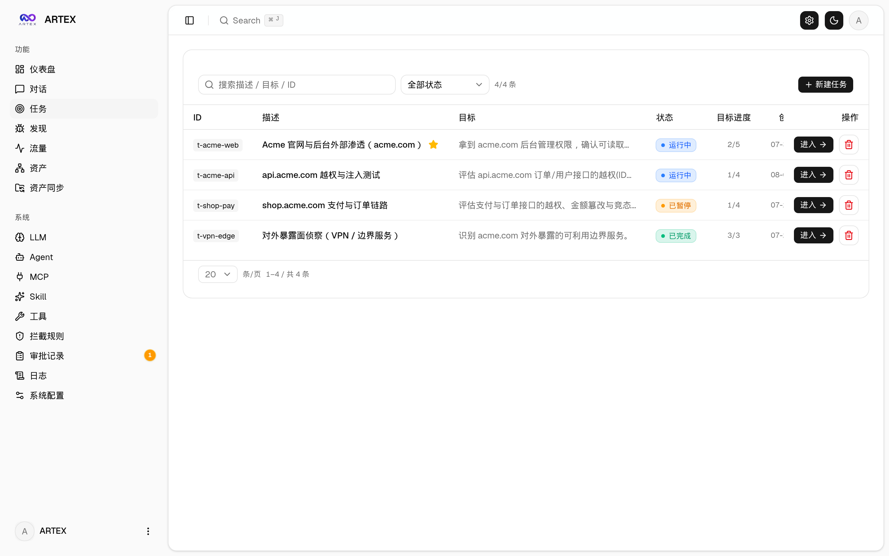
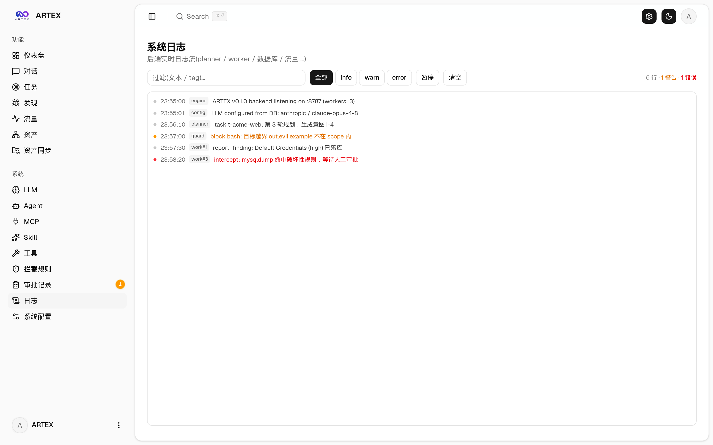

# ARTEX

**ARTEX** is a Go application with a Next.js web interface and PostgreSQL persistence. Its repository describes an LLM-assisted multi-agent security assessment system with task planning, asset and exploration graphs, tool execution, approval/interception controls, traffic evidence, findings, and operator-facing configuration.

This README describes the checked-in code, features, and documented operating procedures. Verify commands and settings against the release being used; no security certification or service-level commitment is implied.

> **Fresh-install warning:** `db/schema.sql` currently contains a placeholder rather than the core schema. Application startup executes this embedded file and then seeds core tables, so a clean PostgreSQL installation is not expected to complete successfully until the schema is restored and tested. Existing databases may behave differently. This repository state has not been runtime-validated.

## Repository and release status

This repository identifies itself as the independently maintained [RuoJi6/ARTEX](https://github.com/RuoJi6/ARTEX), preserving the original [Autumn-27/ARTEX](https://github.com/Autumn-27/ARTEX) commit history. The checked-in changelog's latest dated entry is **0.3.18 (2026-10-12)**; this statement does not establish the latest published GitHub release. Inspect the [Releases page](https://github.com/RuoJi6/ARTEX/releases) for available artifacts and verify their version and provenance before use.

The project documentation points to the [ruoji6/artex Docker image](https://hub.docker.com/r/ruoji6/artex). Because `latest` is mutable, select an explicitly versioned tag or digest and record the deployed image digest.

## Demo

[Open the ARTEX demo](https://artex-demo-ruoji6.vercel.app/).

The demo is a frontend-only Next.js build with `NEXT_PUBLIC_MOCK=1`. It displays mock data and does **not** connect to a Go backend, PostgreSQL, model provider, or real targets. New-version demo data may require maintainer updates in `web/src/lib/mock/`.

The release workflow can invoke the demo workflow after a qualifying release. The checked-in `demo.yml` also supports a manual deployment workflow. To deploy a mock demo in your own Vercel project, use Node.js 22, keep the Vercel project Git-disconnected, set `NEXT_PUBLIC_MOCK=1` for Production, and configure the GitHub Actions values/secrets documented by `.github/workflows/demo.yml`. Do not place a Vercel token in this repository or README. The workflow's `DEMO_URL`, Vercel project/team IDs, and token must refer to the project you control.

## Screenshots

The screenshots below are repository assets and may not reflect the exact UI of every release.

| Dashboard | Tasks |
| :---: | :---: |
|  |  |

| Execution sessions | Exploration graph |
| :---: | :---: |
|  |  |

| Findings | Assets |
| :---: | :---: |
|  |  |

| Asset coverage graph | Traffic recording |
| :---: | :---: |
|  |  |

| Human-in-the-loop chat | Agent and LLM configuration |
| :---: | :---: |
|  |  |

| Intercept approval | Backend logs |
| :---: | :---: |
|  |  |

## Feature map

Feature descriptions summarize repository documentation and are not efficacy, reliability, or security guarantees. Availability can vary by release and configuration; consult the [changelog](CHANGELOG.md) and the relevant code for the version in use.

- **Tasks and agents:** task creation, goals, task templates, scheduled tasks, agent management, task sessions, chat, and human-in-the-loop interactions.
- **Planning and activity:** a planner/worker engine, per-task exploration graph and activity history, worker trace search, and a shared asset graph connected to task exploration through asset anchors. These describe the architecture, not a benchmarked success rate or guarantee of completing a chain.
- **Scope and assets:** company-associated asset records, task scope, asset coverage views, task/global interception rules, and a documented [ScopeSentry asset-sync integration](https://github.com/Autumn-27/ScopeSentry) for importing selected projects/tasks and asset types.
- **Approvals and interception:** approval records, review details, command/tool interception controls, and configured human/model review paths. These controls do not replace independent authorization, deployment controls, or operator review.
- **Execution evidence:** a traffic-recording proxy, traffic search/filter views, task activity, and evidence associated with findings. Repository code describes real tool execution, including Bash/Kali tools and HTTP traffic; this is not merely mock functionality outside the demo.
- **Findings:** raw findings, grouped vulnerability views and merge history, exports, and manual vulnerability retesting. The changelog describes retest outcomes as “Still reproducible,” “Fixed,” or “Cannot confirm”; it also notes that some retest history is not included in exports/task archives in the documented version.
- **Integrations and configuration:** LLM provider settings, MCP (including legacy SSE services), skills, notification channels, proxy configuration, optional HTTP Basic Auth, and a custom IP-detection service. Provider and integration behavior depends on operator configuration and external services.
- **Task intelligence:** an optional auto-recording setting for credentials and other sensitive clues. The repository documentation says records can contain credentials and source evidence and that these contents are displayed directly in task views. Treat this feature and its stored records as sensitive.
- **Archives and updates:** task-level archive/restore functions and program/image update workflows. Task archives are not full-instance disaster-recovery backups; program rollback does not roll back database state.

For version-specific behavior and changes, consult the source tree and `CHANGELOG.md`.

## Requirements and installation options

### Prerequisites

The checked-in files indicate the following toolchain/runtime versions and utilities:

- PostgreSQL **16** in the Compose example.
- Go **1.26.10** as declared by `go.mod` for source builds.
- Node.js **22** in the release workflow for frontend builds; npm is used by frontend scripts.
- `rsync` and `zip` are required by the release build script. Docker and Docker Compose are required for Compose deployment or the installer's Docker-backed database option.

The repository does not document supported CPU/RAM/disk sizing. Worker concurrency is configured in System Settings and defaults to 3 in the README. No scale or capacity guarantee is implied.

### 1. Interactive install script

```bash
git clone https://github.com/RuoJi6/ARTEX.git
cd ARTEX
./install.sh
```

The script offers two paths:

1. **Docker:** checks for Docker/Compose, can offer automatic Docker installation on Linux, creates `.env` if needed, then runs `docker compose pull` and `docker compose up -d`.
2. **Local build:** connects to an existing PostgreSQL database or can start PostgreSQL 16 with Docker, writes `config.json`, and builds the Go program. When npm is available, it builds and embeds the static frontend. If npm is absent, it builds a backend-only program and prints a message to run the frontend separately with `npm run dev`.

The local path starts `./artex` directly. The checked-in page-update flow relies on `start.sh`/`start.bat` to relaunch after an update, so this local install path does not provide that supervisor behavior as written.

The script prints `http://localhost:8787`; first-time setup is described at `/setup`. **The fresh-install warning above applies.** The local Docker database is started asynchronously by the script; the installer does not wait for a PostgreSQL readiness probe before starting ARTEX.

### 2. Docker Compose

```bash
git clone https://github.com/RuoJi6/ARTEX.git
cd ARTEX
cp .env.example .env
# Edit .env and set POSTGRES_PASSWORD before starting.
docker compose up -d
```

Compose runs PostgreSQL 16 and the ARTEX image. The `pgdata` named volume stores PostgreSQL data; `./data` and `./skills` are bind-mounted into the container. The image includes tools as described by the repository, including ripgrep, curl, vim, npm, and nmap.

**Network exposure:** the checked-in Compose mapping publishes `8787:8787` on all host interfaces by default. Port 8788 is bound to `127.0.0.1`. The app listener on 8787 is HTTP. This differs from the reverse-proxy guidance below, which recommends keeping 8787 internal and exposing HTTPS at the proxy. For a proxy-fronted deployment, change the app mapping to `127.0.0.1:8787:8787` (or use an internal-only network) before starting, and verify the effective Docker/network rules. If you intentionally expose the service directly, understand that HTTP is not TLS and restrict it using appropriate network controls; do not treat authentication as transport encryption.

In `.env`, `ARTEX_IMAGE` defaults to `ruoji6/artex` and `ARTEX_TAG` defaults to `latest`. The release workflow targets `linux/amd64` and `linux/arm64` Docker images. Set `POSTGRES_PASSWORD` and review the database, secrets, and network settings before deployment. Compose uses `sslmode=disable` for its internal PostgreSQL connection in this example; this is not a secure remote-database template.

For remote MCP configuration, the UI documents `http` (Streamable HTTP) and legacy `sse`. Legacy SSE services generally use `GET /sse` to establish the event stream and a returned `/message?sessionId=...` URL for JSON-RPC requests; the documented configuration sets the URL to `/sse` and an `Authorization=Bearer <token>` header.

### 3. Prebuilt release archives

Download the archive for the selected platform from [GitHub Releases](https://github.com/RuoJi6/ARTEX/releases). The documented archive contains `artex`, `start.sh` (or `start.bat` on Windows), `skills/`, and `config.example.json`. The release workflow targets Linux amd64/arm64, macOS amd64/arm64, and Windows amd64.

```bash
cp config.example.json config.json
# Edit config.json for the database connection.
./start.sh
```

Use `start.sh`/`start.bat` rather than invoking `./artex` directly when relying on the page update/restart flow. To run the launcher in the background, the repository documents:

```bash
nohup ./start.sh >artex.log 2>&1 &
```

**Configuration caveat:** the checked-in `config.example.json` sets the database port to `5433`, while the README, installer, and common PostgreSQL defaults use `5432`. Set the actual database port explicitly. The config example uses `sslmode: disable`; configure and verify TLS for remote database connections.

### 4. Compile a single binary from source

The documented embedded-frontend build is:

```bash
cd web && npm ci && npm run build:static && cd ..
cp -r web/out server/webui/dist
CGO_ENABLED=0 go build -tags embedui -o artex ./cmd/artex
./start.sh
```

A backend started without `-tags embedui` does not include the frontend. The frontend can be run separately during development; see below. Verify build paths and output names against the checked-out version.

### 5. Build cross-platform release archives

```bash
./build.sh --release
```

The release script builds the frontend, embeds it in Go binaries, strips debug information, and zips target artifacts. By default, the documented targets are Linux amd64/arm64, macOS amd64/arm64, and Windows amd64. Customize targets with `ARTEX_TARGETS`:

```bash
ARTEX_TARGETS=linux/amd64,windows/amd64 ./build.sh --release
./build.sh --target linux/amd64 --upx
```

UPX is disabled by default because self-extracting binaries may not work in some kernels, virtualized environments, or security policies. `rsync` and `zip` are used by the script. The example versioned output path in older README text may be historical; inspect the actual `dist/` contents rather than relying on a stale version example.

## Configuration

### Database

Configuration can be read from `config.json` or supplied with `ARTEX_PG_DSN`; the environment DSN takes precedence over the individual JSON fields. `config.example.json` also describes an alternative full `database.dsn` form. Example only:

```json
{
  "database": {
    "host": "127.0.0.1",
    "port": 5432,
    "user": "artex",
    "password": "replace-me",
    "dbname": "artex",
    "sslmode": "disable"
  }
}
```

Use an appropriate TLS-verifying connection mode for networked databases. Do not use the example's `sslmode=disable` for remote connections without an explicit, reviewed reason and compensating controls.

### LLM and task settings

Set `ANTHROPIC_API_KEY` or `OPENAI_API_KEY`, or configure a supported provider in the UI's LLM Configuration page. Optional environment variables documented by the README are `ARTEX_LLM_PROVIDER`, `ARTEX_LLM_MODEL`, `ARTEX_LLM_BASE_URL`, and `ARTEX_LLM_PROXY`. Agent concurrency is configured in System Settings (documented default: 3).

The command-line address flags documented by the README are:

```bash
./start.sh -addr :8787 -proxy :8788
```

`-addr` configures the frontend/API listener; `-proxy` configures the traffic-recording proxy.

### Optional HTTP Basic Auth

The README documents an optional HTTP Basic Auth access-verification layer under **System Settings → HTTP Basic Auth**. It is off by default; when enabled, the browser's native prompt precedes the ARTEX login. The documented password length is 8 characters minimum and 72 bytes maximum; usernames cannot contain a colon. The Basic Auth cookie is described as HttpOnly and valid for 12 hours. Saving settings invalidates prior verification cookies in other browsers. Basic Auth is an additional access layer; it does not replace TLS or application authentication.

The repository documents a database SQL recovery procedure to disable this layer if its dedicated password is forgotten. Before using any recovery SQL, back up the database and validate the exact schema/version. The `/api/health` endpoint is documented as a liveness response (`{"ok":true}`), not as a PostgreSQL readiness check. It can require Basic Auth when that feature is enabled. `/api/version` requires an application JWT.

### Reverse proxy and HTTPS

The frontend and API/SSE share the backend port, default `8787`. Production uses a same-origin activity stream by default; `NEXT_PUBLIC_SSE_BASE` is only needed if the stream has a different origin and is baked into the frontend at build time. For public-facing deployments, terminate TLS at a reverse proxy and keep 8787 on loopback or a private network. Ensure host firewall and container port mappings agree with that policy.

The repository's Nginx example disables buffering for SSE and uses a long read timeout:

```nginx
server {
    listen 443 ssl;
    server_name your.domain.com;
    # Configure ssl_certificate and ssl_certificate_key.

    location / {
        proxy_pass http://127.0.0.1:8787;
        proxy_set_header Host $host;
        proxy_set_header X-Forwarded-Proto $scheme;
        proxy_buffering off;
        proxy_cache off;
        proxy_read_timeout 3600s;
        proxy_http_version 1.1;
        proxy_set_header Connection "";
    }
}
```

This is a configuration example, not evidence of a hardened or tested production deployment. Reverse-proxy access logs and application logs should not record bearer tokens or sensitive task content.

## Updates and releases

The repository documents these update paths: page-based update, `./update.sh`, Docker Compose image pull/recreate, release archive replacement, and source rebuild. Page-based updates download a platform release archive, compare against the release's `SHA256SUMS`, run a binary smoke test, stage a replacement, and rely on `start.sh`/`start.bat` to complete the swap. The README says official programs check the latest published release and skip drafts/prereleases. Dev builds disable the page updater.

**Integrity caveat:** a SHA-256 checksum distributed through the same release channel can detect corruption or mismatch, but is not an independent signature, publisher-authentication mechanism, or build-provenance attestation. The checked-in release workflow does not include artifact signatures, an SBOM, or a build-provenance attestation.

**Rollback caveat:** the updater retains `artex.old` and attempts recovery after repeated startup failures, but rollback is best-effort and depends on marker and filesystem operations succeeding. Checksum or smoke-test failure occurs before replacement; post-swap failure may still prevent automatic restoration. A program rollback does not roll back database changes. Back up state and preserve logs before updating; do not rely on automatic rollback as a guarantee.

Updating interrupts running tasks because it restarts the process. Under Docker, replacing the program inside a running container does not update the container image; recreating the container returns to the image's built-in program. The README's update-proxy setting supports HTTP, HTTPS, SOCKS5/SOCKS5H, and username/password authentication, and the application server makes the update request. In Docker, `127.0.0.1` refers to the container itself.

### Maintainer release workflow (documented commands)

The checked-in `.github/workflows/release.yml` starts from a `vMAJOR.MINOR.PATCH` tag. Example only; verify version sequencing and branch policy before using:

```bash
git push origin main
git tag v0.3.17
git push origin v0.3.17
```

The workflow definition builds five platform archives, generates `SHA256SUMS`, smoke-tests Linux binary startup, and builds/tests Docker images on AMD64 and ARM64 before publishing. It does not show an artifact signature, SBOM, provenance attestation, or an in-workflow human publication approval. Verify GitHub repository settings, image credentials, branch/tag protection, release approvals, workflow runs, and published artifacts independently.

## Data, privacy, and deployment boundaries

The application can process and persist task and target descriptions, organizations/assets, tool inputs and outputs, activity/chat, uploads/transcripts, findings/evidence, HTTP traffic, and usage metadata. When credential analysis is enabled, records can include usernames, passwords, tokens, and cookies. A gated LLM recorder can capture provider request/response bodies. The exact data retained depends on code path, settings, configured providers, and deployment; operators should inventory the live configuration and records before onboarding sensitive data.

The repository documents that task intelligence may display credential bodies and source evidence directly. LLM request/response records and task archives may also contain sensitive content. Task archive packages are compressed, not encrypted by the archive format. Protect databases, filesystems, exported archives, logs, and backups accordingly, and review provider processing and retention terms before sending customer content.

The application uses a shared `ARTEX` administrator identity and has no tenant or role claim in its authentication model. Company/task scope records should not be treated as customer isolation. Do not treat one shared instance as a multi-customer security boundary without additional implementation and tests.

Task deletion is not demonstrated to erase every related record: optional cleanup flags default off and some usage ledgers persist. Logs have no repository-evident general retention/deletion policy. The README does not provide a tested end-to-end erasure procedure, data-subject request process, data retention schedule, or complete processor list. Do not promise complete erasure or fixed retention based on this README.

The task archive/restore feature archives selected task-related records and files. It is not a full-instance backup: disaster recovery must also account for PostgreSQL, `./data`, `./skills`, deployment configuration and required keys. No complete, tested backup/restore runbook or recovery-time/recovery-point objective is evidenced here.

## Security reporting and support

Community information in this repository points to the SecSentry WeChat official account/group. This is a community link, not a product support commitment or private vulnerability-reporting channel. No security response time or service-level agreement is stated. Establish an accountable support owner and monitored private security-reporting route before relying on support.

## Development and tests

The checked-in development script is documented to start a backend on `:8787`, traffic proxy on `:8788`, and Next.js development frontend on `:5173`:

```bash
./dev.sh
# http://localhost:5173
```

Other documented commands:

```bash
# Backend (without -tags embedui, frontend is not embedded)
go run ./cmd/artex

# Frontend
cd web && npm run dev

# Tests
go test ./...

# Mock-only frontend preview
cd web && NEXT_PUBLIC_MOCK=1 npm run dev
```

Database-dependent Go tests can be skipped when no PostgreSQL DSN is provided. Configure `ARTEX_PG_DSN` to a disposable test database for database-backed coverage, and confirm test output indicates which tests ran. The release workflow's startup smoke checks are not a substitute for the full Go test suite. Consult CI results for the selected commit; this README does not publish a coverage figure.

## Known documentation and release limitations

- `CHANGELOG.md` has an empty `Unreleased` section and lists 0.3.18 as its latest dated entry. README tag examples may be historical; check actual releases.
- `docker-compose.bench.yml` references benchmark build inputs not present in this repository tree. Do not rely on that auxiliary workflow without restoring and validating those files.
- Docker base tags, package installs, global Playwright `@latest` references, and GitHub Actions major-version tags are not all immutable. Rebuilding later may not reproduce identical inputs.
- The checked-in application health endpoint is liveness-oriented and does not establish database readiness. In-app logs/metrics are diagnostics, not evidenced as a durable audit or external monitoring system.
- No sizing guidance, support coverage, production SLA, or performance/efficacy benchmark was identified in the repository.

## License and legal notices

**License declarations in this repository conflict and require resolution.** The root [`LICENSE`](LICENSE) says MIT and identifies Victormokerenki; previous README versions and [`CHANGELOG.md`](CHANGELOG.md) refer to AGPL-3.0; the release workflow uses an AGPL-3.0 image label; and [`web/LICENSE`](web/LICENSE) separately says MIT and identifies Mohammed Arham Khan. Git history records a license-file replacement but does not establish the authority or scope of any grant. This README does not determine the applicable license. Review the actual license files, distribution materials, and rights-holder records with qualified counsel before relying on any license representation or distributing the software.

The application may present separate terms during login; this README does not modify those terms or determine their legal effect. Nothing in this README is a legal opinion, license grant, or authorization to access a system. Security assessments should be conducted only with appropriate authorization and in compliance with applicable laws and contracts.

The root MIT license text includes an “AS IS” warranty disclaimer. This statement does not resolve the conflicting license declarations or establish rights to all code, dependencies, images, or binaries.

## Acknowledgments and references

- Acknowledgments to the MiSecurity team.
- Reference: [Cairn](https://github.com/oritera/Cairn).
- ScopeSentry integration: [Autumn-27/ScopeSentry](https://github.com/Autumn-27/ScopeSentry).
- Approval detail component reference: [AegisHook](https://github.com/RuoJi6/AegisHook/blob/main/web/src/components/CallDetail.vue).

## Community

The project community is listed as the SecSentry WeChat official account and group. See `screenshots/wx.png` for the QR image. Community participation should not be interpreted as a support, security-response, or availability commitment.
