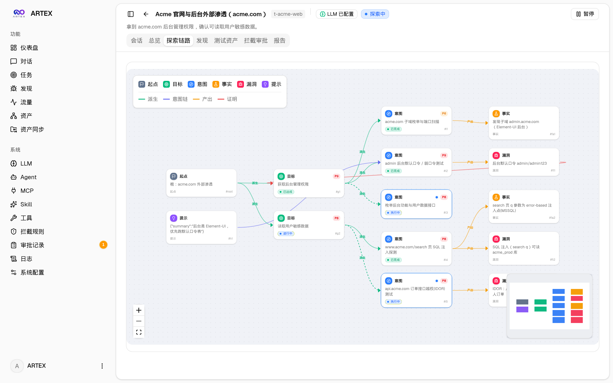
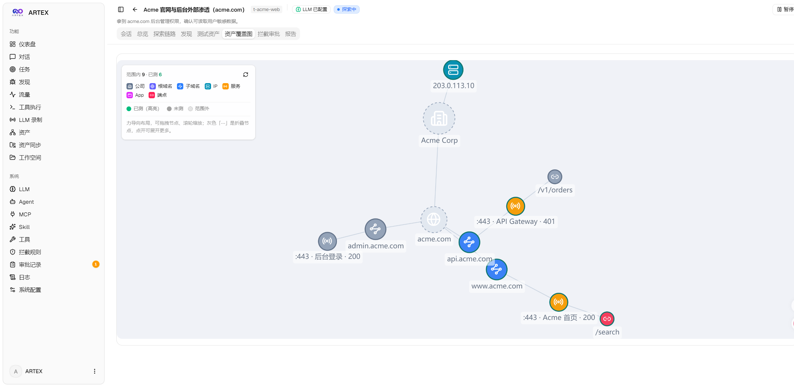
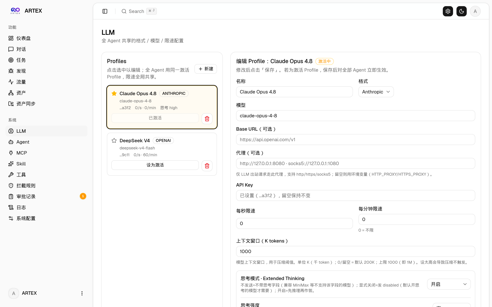
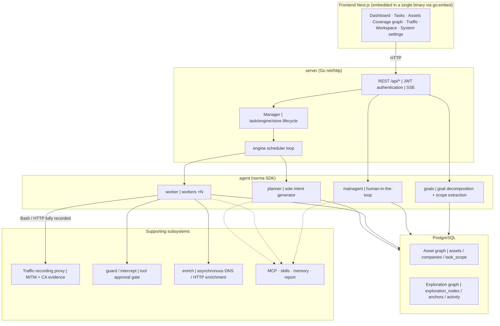
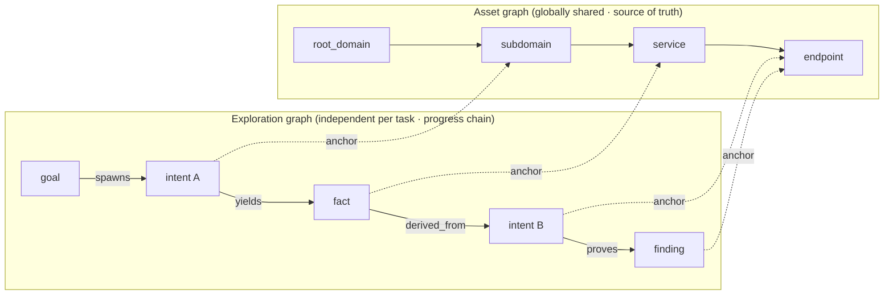
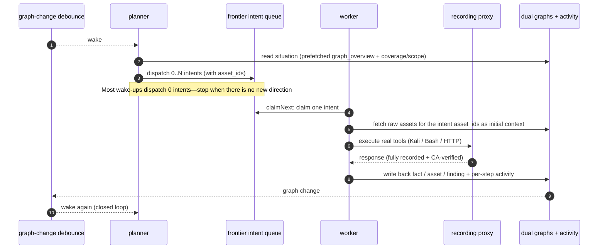
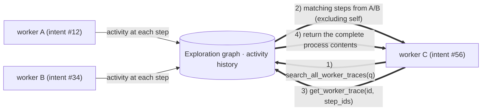
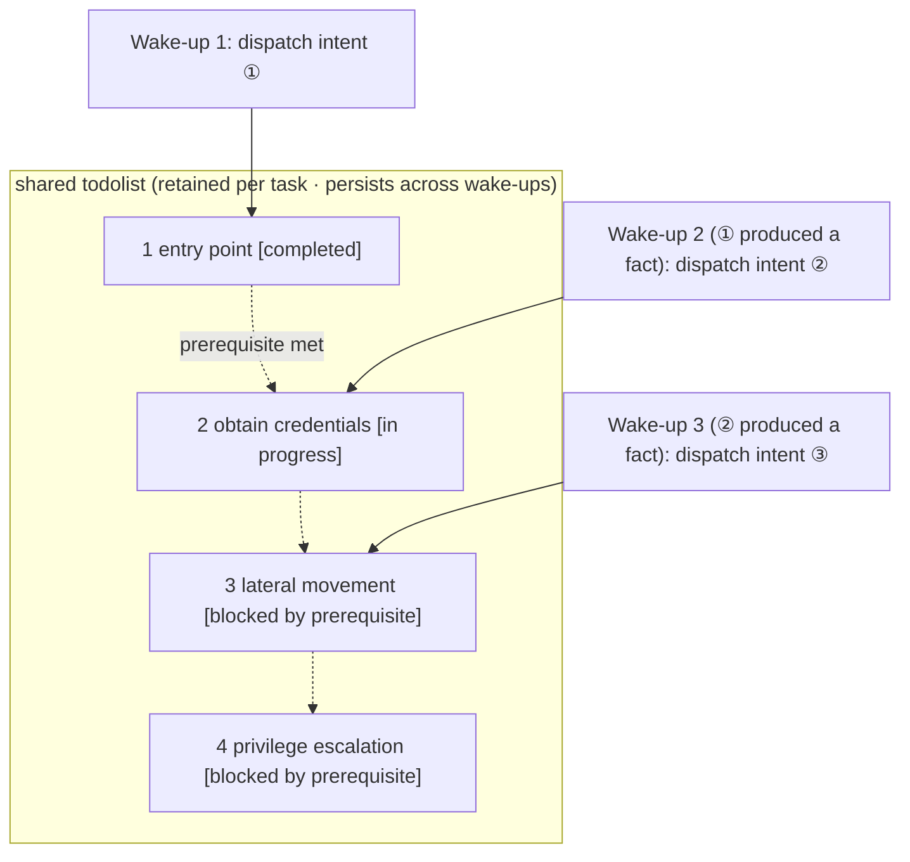

<div align="center">

# ARTEX

AI-powered autonomous penetration testing system (Go backend + Next.js frontend)


🌐 **Online Demo**: [https://artex-demo-ruoji6.vercel.app/](https://artex-demo-ruoji6.vercel.app/)

</div>

This repository is the independently maintained [RuoJi6/ARTEX](https://github.com/RuoJi6/ARTEX), preserving the original commit history and AGPL-3.0 license of https://github.com/Autumn-27/ARTEX. Release packages are downloaded from this repository's Releases, and the Docker image [ruoji6/artex](https://hub.docker.com/r/ruoji6/artex) is built and published by this repository's GitHub Actions.

---
## Acknowledgments
Acknowledgments to the MiSecurity team

## Screenshots

> See the [Online Demo](https://artex-demo-ruoji6.vercel.app/) for the full interactive experience.

| Dashboard (overview / token usage / activity stream) | Task list |
| :---: | :---: |
|  |  |

| Task · Execution process (session / tool calls) | Exploration chain |
| :---: | :---: |
|  |  |

| Findings | Assets |
| :---: | :---: |
|  |  |

| Asset coverage graph (force-directed layout · tested nodes highlighted · collapsible/expandable nodes) |
| :---: |
|  |

| Traffic recording | Human-in-the-loop chat |
| :---: | :---: |
|  |  |

| Agent management | LLM configuration |
| :---: | :---: |
|  |  |

| Intercept approval | Backend logs |
| :---: | :---: |
|  |  |


---

## Approval Record Details

The global "Approval Records", the per-task "Intercept Approval", and approval cards in chat all support expanding to view details. The display structure follows [AegisHook's approval detail component](https://github.com/RuoJi6/AegisHook/blob/main/web/src/components/CallDetail.vue), reusing ARTEX's components and theme:


## Asset Sync (ScopeSentry)

Asset data can be synced directly from [ScopeSentry](https://github.com/Autumn-27/ScopeSentry), eliminating duplicate collection:

- On the **Asset Sync** page, enter the ScopeSentry address and API Key to connect the data source;
- Choose the targets and asset types to sync by **project** or **task** (domain / subdomain / IP / port / site / endpoint...);
- Import in one click and merge by company asset scope, then feed directly into ARTEX's asset graph for agents to explore.

---

## Deploy Your Own Online Demo (auto-updated with each official Release)

The demo only runs the `web/` frontend, built with `NEXT_PUBLIC_MOCK=1`, and needs no Go, PostgreSQL, or model keys. The UI uses mock data and does not perform real scans.

Release pipeline: the official version's program packages, `SHA256SUMS`, and Docker images are all published successfully → the `demo` job of `release.yml` invokes `demo.yml` → checks out the commit for that version tag → builds the mock frontend → deploys to Vercel's fixed production domain. Ordinary main pushes, tag-only creation, failed releases, drafts, and prereleases do not update the demo. Demo data for new version features still needs to be maintained by the maintainer in `web/src/lib/mock/`.

### First-time Vercel setup

1. Create an empty project in your own Vercel account and set a name (for example `artex-demo-ruoji6`). Keep **Git disconnected** to avoid automatic deploys on every commit. `web/vercel.json` also disables Git auto-deploy.
2. Under **Settings → Build and Deployment**, select **Next.js**, Node.js **22.x**; the install command can be overridden to `npm ci`, the build command is `npm run build`, and Output Directory stays default. **Leave Root Directory empty**: this workflow invokes the Vercel CLI from the checked-out `web/` directory, so you must not add another `web` layer.
3. Add `NEXT_PUBLIC_MOCK=1` under the project's **Environment Variables**, applied at least to **Production**. Do not set `NEXT_EXPORT=1`, and do not fill in database connections or model keys.
4. Copy the **Project ID** from the project's **Settings → General**; copy the **Team ID** from the team's **Settings → General** (corresponding to `VERCEL_ORG_ID`). Confirm that the production domain you plan to use exists under **Domains**.
5. Create a deploy token under Vercel **Account Settings → Tokens**, choose the team that owns the project as the scope, and set an appropriate expiration. Save it directly to the GitHub repository's **Settings → Secrets and variables → Actions → Secrets** under the name `VERCEL_TOKEN`. Do not write the token into the repository, README, or chat; when it expires, update this secret.

Add the following under **Variables** on the same GitHub settings page:

| Variable | Value |
| --- | --- |
| `VERCEL_ORG_ID` | Vercel Team ID |
| `VERCEL_PROJECT_ID` | Vercel Project ID |
| `DEMO_URL` | Fixed public production URL, including `https://`, for example `https://artex-demo-ruoji6.vercel.app` |

### First deployment and retry

After merging the configuration into the default branch, open **Actions → deploy-demo → Run workflow**, select branch `main`, and leave the tag empty or enter the current latest official version (for example `v0.3.21`). The workflow only accepts the latest official release that is published and contains the five-platform program packages and checksum file; it can also deploy historical official releases that do not yet contain this workflow. There is no need to re-publish a Release or move existing tags.

The workflow sets this dedicated demo project's framework to Next.js, Node to 22.x, root directory to empty, install command to `npm ci`, build command to `npm run build`, and ensures `NEXT_PUBLIC_MOCK=1` for Production, then binds the domain specified by `DEMO_URL`. Use a separate project; subsequent deploys will keep maintaining these settings.

After success, visit the production domain and check `tag`, `commit`, and `mock: true` in `/demo-version.json`. Once it is confirmed accessible, change the old demo links at the top of the README and in the screenshot section to your own production domain.

From then on, simply publishing a higher version through the normal process will update the demo automatically. If the demo deployment fails, the published packages and images remain valid, and the old demo usually continues to serve; after fixing the settings, rerun `deploy-demo` alone, without re-publishing the entire Release. When two versions are published at the same time, deployments run serially and check `latest` before building and before going live, to avoid an outdated build overwriting the new version.

The release workflow invokes the deploy job directly here because a Release created with `GITHUB_TOKEN` does not trigger another `release: published` workflow. `demo.yml` also listens for manually published Releases from the web page and deploys after the same official-version, complete-release-package, and latest checks; a manual retry runs `deploy-demo`.

---

## Installation

> Requires the **PostgreSQL** database; exploration requires an **LLM** to be configured (`ANTHROPIC_API_KEY` or `OPENAI_API_KEY`, or configure it in the UI).

### Method 1: One-click install script (recommended)

```bash
git clone https://github.com/RuoJi6/ARTEX.git
cd ARTEX
./install.sh
```

The script will: detect / automatically install Docker → let you choose **① all Docker** or **② build and run locally**:

- **① All Docker**: enter a Postgres password (press Enter for a random one) → automatically writes `.env` → `docker compose up -d`.
- **② Local run**: choose the database (connect to an existing one / start one with Docker) → generate `config.json` → `go` compiles an embedded single binary → start.

Once installed, open **http://localhost:8787** (on first entry, set the administrator password at `/setup`).

### Method 2: Docker Compose (manual)

```bash
git clone https://github.com/RuoJi6/ARTEX.git
cd ARTEX
cp .env.example .env          # set POSTGRES_PASSWORD and optionally ANTHROPIC_API_KEY
docker compose up -d          # pull the ruoji6/artex image + postgres
# → http://localhost:8787
```

The image already includes common tools (ripgrep/curl/vim/npm/nmap...); `./skills` and `./data` are persisted via bind mounts.

In `.env`, `ARTEX_IMAGE=ruoji6/artex` and `ARTEX_TAG=latest` use the latest image by default; you can also pin it to `v0.3.17` (full image address `ruoji6/artex:v0.3.17`). The image supports `linux/amd64` and `linux/arm64`, and Docker automatically selects the architecture matching the host, so ARM64 Kali needs no self-compilation. On first deployment, change `POSTGRES_PASSWORD`; running the service does not require a Docker Hub publish token.

For remote MCP, you can choose `http` (Streamable HTTP) or `sse` (legacy SSE) in system settings.
Legacy SSE services usually establish the event stream with `GET /sse`, then receive JSON-RPC requests via the
`/message?sessionId=...` returned by the service; when configuring, set the URL to `/sse` and fill in the header as
`Authorization=Bearer <token>`.

### Method 3: Download prebuilt binaries (Releases)

Download the zip for your platform from this repository's [Releases](https://github.com/RuoJi6/ARTEX/releases); after extraction you get `artex` + `start.sh` (`start.bat` on Windows) + `skills/` + `config.example.json`. Choose `linux-arm64` for Linux ARM64 (including ARM64 Kali) and `linux-amd64` for x86_64:

```bash
cp config.example.json config.json   # configure the database connection
./start.sh                           # → http://localhost:8787
```

> Please start with `start.sh` / `start.bat` instead of running `./artex` directly. It is a daemon script: after the program exits, it decides whether to relaunch based on the exit code, and **[the one-click update on the page](#method-1-one-click-page-update-recommended) relies on it to swap binaries**. If you run `./artex` directly, it will not be relaunched after an update.
> To keep it running in the background: `nohup ./start.sh >artex.log 2>&1 &`.

### Method 4: Compile a single binary from source

```bash
# 1) Export the frontend static files
cd web && npm ci && npm run build:static && cd ..
# 2) Copy them into the embedded frontend directory
cp -r web/out server/webui/dist
# 3) Compile (-tags embedui embeds the frontend)
CGO_ENABLED=0 go build -tags embedui -o artex ./cmd/artex
./start.sh
```

### Method 5: Build cross-platform Release archives

`build.sh` first builds and embeds the frontend, then uses the Go linker to strip debug information, and compresses the release files into a zip. Release mode generates zips for Linux amd64/arm64, macOS amd64/arm64, and Windows amd64 by default:

```bash
./build.sh --release
# Output: dist/artex-0.3.3-*.zip
```

UPX self-extracting binaries may be incompatible with some Linux kernels, virtualization environments, or security policies, so they are disabled by default. Use `ARTEX_TARGETS` to customize targets; when you have confirmed the target runtime environment is compatible, you can explicitly pass `--upx` to further shrink the binary:

```bash
ARTEX_TARGETS=linux/amd64,windows/amd64 ./build.sh --release
./build.sh --target linux/amd64 --upx
```

---

## Update and Upgrade

> An upgrade only replaces the program and does not touch data: the Postgres data volume `pgdata`, `./data` (jwt.key / SQLite, etc.), and `./skills` are all preserved. **No manual database migration is required** — `artex` idempotently reruns `schema.sql` (including `ADD COLUMN` / `CREATE INDEX IF NOT EXISTS`) on every startup, i.e. "restart means migrate". Even so, it is still recommended to back up `./data` and the database before upgrading.

### Method 1: One-click page update (recommended)

On the **System Settings** page (sidebar "System Settings" → `/system/settings`), the **Version and Updates** card lets you check for and install a new version directly, without logging into the server.

Programs built by this repository always check for updates against the latest official GitHub Release of `RuoJi6/ARTEX`, skipping drafts and prereleases. Older official programs still point to the original author's repository, so the first switch must install a program built by this repository manually; afterwards, publishing a higher three-part version allows upgrading through the page. Pushing only to main or a Git tag without publishing a Release does not produce a new version that can be installed online.

After clicking **Update**: download the release package for the current platform → compare against the Release's `SHA256SUMS` → smoke-test the new binary with `-h` → stage it as `artex.new` → the program exits and `start.sh` / `start.bat` relaunches it to complete the swap. The page automatically waits for the new version to come online and then refreshes.

- **A failure never leaves a broken program**: if the checksum or smoke test fails, the staged file is discarded and the current version keeps running; if the swapped-in new version fails to start 3 times in a row, it automatically rolls back to `artex.old` (the failed one is kept as `artex.failed` for troubleshooting).
- **You can roll back at any time**: the previous version is kept as `artex.old`, and the card has "Roll back to previous version". Note that the database schema is not rolled back.
- **An update interrupts running tasks** — updating means restarting, so do it when idle.
- **Dev builds are not offered updates**: it is disabled when the version is `dev` or `git describe` has a suffix, to avoid an official version overwriting a locally debugged binary.
- **Under Docker, only the program is replaced, not the image**: toolchains such as playwright / nmap inside the image are not upgraded, and after `docker compose up -d` recreates the container it falls back to the image's built-in version. To upgrade the image as well, still use `docker compose pull artex && docker compose up -d artex`.
- **Update proxy (optional)** uses the same "address input + save" approach as other proxy settings. After filling in a dedicated update proxy and saving, for example `http://127.0.0.1:7897`; `http://`, `https://`, `socks5://`, `socks5h://`, and username/password authentication are supported. Clearing and saving means a direct connection, unaffected by the global proxy or `HTTP_PROXY` / `HTTPS_PROXY` environment variables. After saving, it automatically rechecks; the version check, checksum, and release package download use the same egress. Updates only download from GitHub domains and enforce HTTPS.
- The proxy address is accessed by the **ARTEX server**. `127.0.0.1` inside Docker refers to the container itself; when the proxy runs on the host, use an address reachable from the container (usually `http://host.docker.internal:7897` on Docker Desktop) and allow the container to access the proxy port.

### Maintainer: publish online updates via GitHub Actions

The release workflow is `.github/workflows/release.yml`. Pushing an official tag triggers the build; you can also re-run a failed release by entering an existing tag in Actions → release → Run workflow. The tag must be `vMAJOR.MINOR.PATCH`, for example `v0.3.17` below; subsequent versions must be higher than the version the user is running.

```bash
git push origin main
git tag v0.3.17
git push origin v0.3.17
```

The workflow pins the commit for the tag, exports the frontend with Node.js 22, compiles the five platform programs with the Go version specified in `go.mod` (embedding the frontend), and generates ZIPs and `SHA256SUMS`. The AMD64 and ARM64 images are built on GitHub's native runners, connecting to a temporary PostgreSQL to verify program startup, version, and the embedded frontend; after both architectures pass, it publishes the multi-arch image's version tag and `latest`. After the image is published, it uploads the full ZIPs and checksum files, and finally publishes the Release. An already-published release of the same version cannot be overwritten; publish a new tag instead.

Maintainers need to configure the variable `ARTEX_DOCKER_IMAGE` (Docker Hub username/image name) and the secrets `DOCKERHUB_USERNAME`, `DOCKERHUB_TOKEN` (with image push permission) in this repository's Settings → Secrets and variables → Actions. Packages are uploaded via GitHub's built-in `GITHUB_TOKEN`; images are pushed to Docker Hub with the above credentials. The credentials are only used for the workflow to log in and are not written into the source or the image. The image address is also recorded in `.env.example` and the Compose defaults.

### Migrate an existing Docker deployment to this repository's image

In the original deployment directory, back up `.env`, the Compose files, `data/`, and the PostgreSQL data, keeping the original database volume and skills mount. Set `.env`'s `ARTEX_IMAGE` to this repository's image address and `ARTEX_TAG` to the target version; if the old Compose still hardcodes the original author's image, you can create the following override file (if an override file already exists, merge the image configuration into it):

```yaml
# docker-compose.override.yml
services:
  artex:
    image: ${ARTEX_IMAGE}:${ARTEX_TAG:-latest}
```

Then update only the application container:

```bash
docker compose pull artex
docker compose up -d --no-deps artex
curl --fail http://127.0.0.1:8787/api/health
docker compose logs --tail=50 artex
```

Continue using the original deployment directory and Compose project name, ensuring `./data`, `./skills`, and the PostgreSQL data volume still point to the original data. After migration, the program checks for online updates from `Ruoji6/ARTEX`; afterwards you can update the program via the page or update the whole image with the commands above.

When migrating an existing Docker deployment for the first time, extract the verified new ARM64 ZIP onto the host, back up the original program, then replace only `/app/artex` inside the existing container. For example, if the existing container is named `artex-artex-1`:

```bash
# Run from the download directory; verify the downloaded ZIP against SHA256SUMS before extracting.
sha256sum --ignore-missing --check SHA256SUMS
unzip artex-0.3.17-linux-arm64.zip
sudo docker stop artex-artex-1
sudo docker cp artex-artex-1:/app/artex ./artex-before-migration
sudo docker cp ./artex-0.3.17-linux-arm64/artex artex-artex-1:/app/artex
sudo docker start artex-artex-1
curl --fail http://127.0.0.1:8787/api/health
```

This preserves the existing database, data, and skills mounts. Log into the system settings page to check the update source and version. The program replaced inside the container still belongs to the container's writable layer; deleting or recreating the container loses the replacement, so when a rebuild is needed, use an image that contains this repository's program. A program rollback does not revert database migrations, so back up the database and data before upgrading.

### Method 2: One-click update script

```bash
cd ARTEX
./update.sh
```

The script first optionally runs `git pull` to fetch the latest code, then lets you choose **① Docker update** or **② local compile update** (matching `install.sh`):

- **① Docker**: you can specify the target image tag (press Enter to reuse `.env`'s `ARTEX_TAG`, defaulting to `latest`) → `docker compose pull` → `docker compose up -d` (restarting with the new image migrates automatically).
- **② Local**: rebuild the frontend static output → recompile `./artex` (takes effect after restarting the process).

### Method 3: Docker Compose (manual)

```bash
cd ARTEX
git pull                       # update Compose files / scripts (optional)
# To pin a version, set ARTEX_TAG=v0.3.17 in .env; otherwise latest is used
docker compose pull artex
docker compose up -d artex     # restart with the new image → schema migrates automatically
docker image prune -f          # remove old images (optional)
```

### Method 4: Prebuilt binaries (Releases)

Download the new version's zip from [Releases](https://github.com/RuoJi6/ARTEX/releases), stop the old process, overwrite `artex` and `skills/` (keeping your `config.json` and `data/`), and restart:

```bash
cp -r <extracted-directory>/skills ./ && cp <extracted-directory>/artex ./
./start.sh
```

### Method 5: Compile from source

```bash
git pull
cd web && npm ci && npm run build:static && cd ..
cp -r web/out server/webui/dist
CGO_ENABLED=0 go build -tags embedui -o artex ./cmd/artex
# Restart ./start.sh
```

---

## Configuration

**Database** (`config.json`, or override with the environment variable `ARTEX_PG_DSN`):

```json
{
  "database": {
    "host": "127.0.0.1", "port": 5432,
    "user": "artex", "password": "yourpass",
    "dbname": "artex", "sslmode": "disable"
  }
}
```

**LLM**: `export ANTHROPIC_API_KEY=sk-...` (or `OPENAI_API_KEY`), or fill it in on the UI's "LLM Configuration" page.
Optional: `ARTEX_LLM_PROVIDER` / `ARTEX_LLM_MODEL` / `ARTEX_LLM_BASE_URL` / `ARTEX_LLM_PROXY`.

**Concurrency**: the number of work agents per task is configured in "System Settings" (default 3).

**Common parameters**: `./start.sh -addr :8787 -proxy :8788` (`-addr` frontend + API, `-proxy` traffic recording proxy). The startup script passes the parameters through to `artex` unchanged.

### Optional HTTP Basic Auth access verification

In **System Settings → HTTP Basic Auth**, enter a dedicated verification username and password, enable "Enable access verification", and click "Save access verification". It is off by default and takes effect immediately after saving, with no restart needed; the password must be at least 8 characters and at most 72 bytes, and the username cannot contain a colon.

Once enabled, visitors first complete the browser's native username/password verification, then reach the original ARTEX login page. Web pages, static assets, and APIs are all protected; the GET/HEAD health check at `/api/health` must also pass Basic Auth and returns `401` when unauthenticated; after passing, it only returns `{"ok":true}`, without exposing the application name or version. The health check does not additionally require an administrator JWT; external probes need the same Basic Auth credentials configured, for example using `curl --fail --user 'verification-user' http://127.0.0.1:8787/api/health` and entering the password when prompted. When Basic Auth is not enabled, the original credential-free liveness behavior is preserved. The version number is provided by `/api/version`, which requires an administrator JWT; when access verification is enabled, this endpoint is also protected by Basic Auth. The Basic Auth realm for unauthenticated requests uses the generic name `Restricted`; passing access verification still requires logging into ARTEX to use business APIs. For public deployments, please access via HTTPS.

When upgrading from an older web version that still read the version from `/api/health`, the old page may not be able to automatically determine that the upgrade is complete; after the service restarts, manually refresh the page. The new web version's version display and upgrade polling both use `/api/version`.

The configuration is persisted to the database, the password is stored only as a bcrypt hash, and the UI never echoes it back. Leaving the password blank when saving means no change; when disabled, the credentials are kept for easy re-enabling. The dedicated HttpOnly verification cookie is valid for 12 hours and is compatible with the existing JWT and SSE; saving the configuration invalidates the old verification cookies in other browsers, while the current administrator browser stays signed in. Browsers may cache Basic Auth credentials, so use a new incognito window to check the verification prompt.

Docker and the embedded-frontend binary support this feature directly. The auth check in `next dev` only forwards credentials to the loopback backend on the local machine (`localhost`, `127.0.0.1`, or `::1`); the frontend and backend should use the same hostname. A remote development backend can still be used when verification is not enabled; when it is enabled, access the remote service through the embedded frontend to avoid cross-origin verification cookie issues.

If you forget the dedicated verification password, connect to the application database on the server and run the following statement, then restart ARTEX to disable this layer of access verification, and log in with your original ARTEX account to reconfigure it:

```sql
UPDATE settings
SET value = jsonb_set(value::jsonb, '{enabled}', 'false'::jsonb)::text,
    updated_at = now()
WHERE key = 'auth.http_basic';
```

### Reverse proxy deployment (HTTPS / only port 443 open)

Both the frontend and API/SSE are served by the same backend port (default `:8787`), and the live activity stream uses a **same-origin** address by default, so **there is no need to configure `NEXT_PUBLIC_SSE_BASE`**; for public exposure, open only 443 and keep 8787 on the internal network.

SSE is a long-lived connection with continuous pushes, so the reverse proxy **must disable buffering**; otherwise the browser can connect but receives no events (appearing as an activity stream that spins forever). Nginx example:

```nginx
server {
    listen 443 ssl;
    server_name your.domain.com;
    # ssl_certificate / ssl_certificate_key ...

    location / {
        proxy_pass http://127.0.0.1:8787;
        proxy_set_header Host $host;
        proxy_set_header X-Forwarded-Proto $scheme;

        # SSE essentials: disable buffering, use a long timeout, and HTTP/1.1
        proxy_buffering off;
        proxy_cache off;
        proxy_read_timeout 3600s;
        proxy_http_version 1.1;
        proxy_set_header Connection "";
    }
}
```

> Only when SSE needs to use a different origin from the page (such as a separate subdomain) should you set `NEXT_PUBLIC_SSE_BASE` **at build time** (this variable is baked into the static bundle during `next build`; setting it again at container runtime has no effect).

---


## Development

### Merging the same vulnerability and unified reporting

The findings page defaults to "By vulnerability". Raw reports, per-task, and per-asset views keep the original tables, statuses, and action buttons; only merged records are changed into expandable vulnerability folders. Within the same task, after the Reporter confirms the same actual defect based on target, endpoint parameters, permission boundary, root cause, and verification evidence, it forms a folder; identical type or name alone is not used as an automatic merge criterion. Different severity, endpoint, backend, or read/write impact may still be the same vulnerability; conversely, sharing a login entry or token alone does not prove the same root cause. When there is a relationship but the common root cause cannot be confirmed, submit a manual suggestion. The folder's `critical/high/medium/low` counts are based on the raw records, for example `0/1/1/1`; the findings page's independent vulnerability count is deduplicated per folder, severity counts are based on raw reports, and neither the list nor folder details show a unified rating label. Raw report content, rating, status, report, and evidence are not overwritten.

Click the arrow to expand the raw records; click the folder title to view the unified report, raw records, and merge history. Suggestions with insufficient evidence require clicking "Confirm merge"; after rejection or removal, these relationships will not be automatically merged again by the Agent. Removing a member does not delete the original vulnerability; when fewer than two remain, the folder is dissolved and history is kept. Vulnerability groups from inherited tasks remain read-only.

New reports are generated by the existing Reporter as independent reports and checked for duplicates. The upgrade first adds the Reporter's merge tools and operating instructions for the first time, preserving custom prompts and trigger settings; deleted or disabled Reporters are not rebuilt or enabled. History is not scanned automatically: expand and select raw records, click "Organize selected", queue them per task, and view execution records and failure messages. If the same task already has an organize operation queued or running, duplicate submissions are rejected. Historical organizing reuses the original report in read-only mode and is prohibited from overwriting the original report or attaching evidence retroactively; if the existing report is empty or outdated, state so truthfully and handle it separately through the report-writing process. Before finishing, a root-cause judgment for each selected record must be submitted, and the read scope, suggestions, unified report completeness, and version are checked; completion is shown only after passing acceptance. Folder details allow regenerating the unified report; the Reporter must be enabled with an available model configured. Judgment and writing consume model tokens; candidate retrieval returns summaries page by page first, detail evidence is read on demand, and the target is not re-probed.

After members, reports, or evidence change, the unified report is marked as pending update, and the actually read version is validated when writing. Export defaults to one unified report per group plus unmerged records, with an optional "Include original sub-reports"; when the unified report is not generated or is outdated, a clear explanation and all raw materials are attached. Raw reports show the owning task, asset, and time; expand the task first, then the vulnerability folder; the asset view keeps the asset tree, and matching any member shows the whole folder, marking members that do not match the filter when expanded. Collapsed state only reads lightweight summaries and does not load member reports. The upgrade reuses the idempotent database migration at startup, with no separate SQL to execute.

### Manual vulnerability retesting

The **Retest** tab in task details lets you page through this task's vulnerabilities, view past conclusions and evidence, and manually trigger a retest. After starting, the current tab is kept, showing a spinner and "Retesting"; once the fix is confirmed, the vulnerability status is updated accordingly.

Click **Retest** in the action area of each row in the vulnerability list, or click **Start retest** in the "Vulnerability Retest" area of the vulnerability details, fill in the optional fix version, test conditions, or constraints, and the system creates a separate retest Agent session, keeping the current page after starting. The list's flat, per-task grouped, and asset views all support this entry; while a retest is running, a spinner and "Retesting" are shown, click to enter the corresponding session when needed, and it returns to "Retest" when finished. Retesting does not require restarting the original scan task; conclusions are "Still reproducible", "Fixed", or "Cannot confirm", and each conclusion, evidence, and session link is saved in the vulnerability details.

On first startup, the new backend preloads an editable "Vulnerability Retest" (`retester`) Agent, whose prompt, LLM, run budget, and tools can be configured in Agent Management. It uses its bound LLM by default, or the globally active configuration if none is bound. When a retest session completes successfully with the conclusion "Fixed", the system automatically changes the vulnerability disposition status to "Fixed"; in-progress, failed, stopped, or other conclusions keep the original status. Original evidence and reports are always preserved. You can also manually select "Fixed" from the status dropdown. While the same vulnerability is being retested, an existing session is reused; after stopping, failure, or a service restart, a new one can be started.

In this version, history is viewed through the vulnerability details and sessions; it is not yet included in vulnerability report exports or task archive packages, nor is it automatically linked to traffic packets. Demo mode only generates clearly labeled mock records and does not request real targets.

### Custom IP detection service

In **System Settings → Traffic and Security**, expand **Custom IP detection service (optional)**, enter a reachable HTTP / HTTPS echo service, and click **Save detection service**. The service must return a plain-text IP or JSON in the format `{"ip":"1.2.3.4"}`. Intranet addresses are supported; restrictions on the local machine, link-local addresses, and cross-host redirects are preserved.

After saving, the top bar's egress IP, proxy test, proxy pool health check, and auto-reconnect all use this address, and it remains in effect after refreshing the page or restarting; if the custom service fails, the default public service is not tried again. Clearing the address and saving restores the default api.ipify.org / ifconfig.me. You can also click **Test proxy** first to verify temporarily; the test does not save the address.

### Local run and test

```bash
./dev.sh    # backend (:8787) + traffic proxy (:8788) + frontend next dev (:5173) → http://localhost:5173
```

- Backend: `go run ./cmd/artex` (without `-tags embedui`, the frontend is not embedded)
- Frontend: `cd web && npm run dev` (`/api` is reverse-proxied to the backend, with hot reload)
- Test: `go test ./...`
- Mock preview (no backend): `cd web && NEXT_PUBLIC_MOCK=1 npm run dev`

---

## System Technical Architecture

ARTEX is an **LLM multi-agent-driven autonomous penetration system**: a Go monolith backend (with an embedded Next.js frontend) + PostgreSQL, with agent capabilities provided by the [`norma`](https://github.com/Autumn-27/norma) SDK (`agentcore` / `tool` / `permission` / `harness` / `memory` / `transcript`). The core is a **dual-graph architecture**, plus two autonomy mechanisms built around it: **process-level information exchange between workers** and **a planner multi-round shared todolist for a stable attack chain**.

### Overall layering



| Layer | Responsibility |
| --- | --- |
| **Frontend** | Next.js static export, embedded into a single binary via `go:embed`; visualizes tasks/assets/exploration chain/coverage graph, with human-in-the-loop chat |
| **server** | `net/http` routing + JWT auth + SSE; the `Manager` manages the lifecycle of tasks, engines, and DB stores |
| **engine** | One `plannerLoop` + N worker goroutines per task; intent claiming, timeout/pause/drain |
| **agent** | goals / planner / worker / mainagent; the `ToolSet` exposes the dual graphs as LLM tools |
| **db** | Postgres persistence for the dual graphs (pgx); the schema idempotently creates tables on every startup via `go:embed` |
| **Support** | Recording MITM proxy, approval gate, async enrichment, MCP/skills/memory/report |

### Dual-graph architecture: exploration graph + asset graph

The system splits "**what is the target**" and "**how far has testing progressed**" into two mutually independent graphs that are connected via anchors:

- **Asset graph (globally shared)**: the asset source of truth shared across tasks. Nodes are `root_domain / subdomain / ip / service / app / endpoint`, owned by a company; the parent-child relationships and dedup keys from domain → subdomain → service → endpoint are all computed by the program, and the agent only submits raw information.
- **Exploration graph (independent per task)**: the "thinking and progress" process of a single task. Nodes are `goal / intent / fact / finding (vulnerability) / hint`, connected into a **lineage chain** by edges such as `spawns / derived_from / yields / proves`, answering "which direction was derived from which facts and what it produced".
- **The two graphs are connected via anchors**: `exploration_anchors(node_id, asset_id)` anchors intents/facts/findings to specific assets — so you can see which assets a direction targets, and conversely trace which intents tested a given asset in this task and what facts were derived. This also supports **asset test coverage** and the **asset coverage graph** (in-scope assets + tested highlighting).



> Division of labor: the **planner** reads the exploration graph's situation, judges the target, and only dispatches **intents** into the frontier when there are uncovered new directions; the **worker** claims **one intent**, executes it with real tools, writes new assets/facts/findings back to both graphs, and then stops. The asset graph is shared fact; the exploration graph is each task's progress chain.

### Engine and intent lifecycle (the closed loop of one exploration)

The engine is an **event-driven** closed loop: whenever a graph changes it wakes the planner, the planner dispatches intents, workers claim intents, execute them, and write back, and the write-back triggers the next round — until the goal is proven (`prove_goal`).



### Process-level information exchange between workers

In a deep exploration, many valuable observations (a certain error, a certain response segment, a hidden parameter) appear in a worker's **execution process** but may not be written up as a formal fact. To avoid duplicate work and let workers on the chain stand on each other's shoulders, workers have the ability to **search across work processes**:

- `search_all_worker_traces(q)`: search by keyword in **the execution processes of other work in this task** (automatically excluding the steps of your own intent), with hits carrying `intent_id`;
- `list_worker_traces` / `get_worker_trace(intent_id, step_ids=[…])`: first see which work has run, then fetch the full content of specific steps of a given work for detailed exchange.

This way, even if there is no corresponding fact on the exploration graph yet, later workers can reuse observations from others' processes — **information flows between workers at the granularity of "execution process"**, while the boundary stays unchanged (each worker still only does the intent it claimed).



### Planner multi-round shared todolist → a stable attack chain

Real attack chains are often **multi-step sequences with sequential dependencies** (for example: find an injection point → obtain credentials → move laterally → escalate privileges); dispatching them all in parallel at once would only cause chaos. The planner therefore keeps a **per-task, cross-wakeup shared planning todolist**:

- The planner is event-driven — it is woken whenever a graph changes, but **each wakeup is a brand-new session**; the shared todolist lets it **record a serial exploitation chain once** and then **dispatch intents step by step according to dependencies** in subsequent rounds, instead of expanding the whole chain up front in one round;
- Each round only dispatches an intent for the next step whose "prerequisite steps are complete and the facts it depends on already exist", and updates the list as progress is made (marking steps already satisfied by facts as complete).



Thus, even in an "event-driven + stateless session" environment, the attack chain still **advances stably, without repetition or out-of-order steps** — this is the key to ARTEX being able to autonomously complete multi-step exploitation chains.

---

## Community

Scan the QR code to follow the WeChat official account **SecSentry**, and send a direct message in the official account backend to join the group.

<div align="center">


</div>

---
## References

https://github.com/oritera/Cairn


## License and Disclaimer

### Open-source license

This project is licensed under the **GNU Affero General Public License v3.0 (AGPL-3.0)**; see the [LICENSE](LICENSE) file in the repository root for the full terms.

This means anyone may freely use, modify, and distribute this project, but **derivative works must also be open-sourced under AGPL-3.0**; in particular, **if you modify this project and provide it to users over a network (such as deploying it as an online service), you must also make the complete corresponding source code available to those users**.

> ⚠️ **Important note**: the open-source license itself does not restrict the purpose for which the software is used. The "Usage restrictions" and "Disclaimer" below are additional agreements and solemn statements by the author to users, and must be observed.

**ARTEX is for personal learning, code research, and local technical verification only, and must not be used to conduct actual testing against any online system or website.**

### Permitted scope of use

- It may only be used to **read, study, and research this project's source code**, and to verify technical principles in a **local isolated environment**;
- It is suitable for non-attack purposes such as personal learning, academic research, and code review.

### Prohibited items

- **It is strictly forbidden to use this tool to scan, probe, exploit, or attack any website, online service, or networked system** (regardless of whether authorization has been obtained or whether it is your own asset);
- It is strictly forbidden to use this tool for any actual penetration testing, attack/defense exercises, or production environments;
- It is strictly forbidden to use this tool for illegal intrusion, data theft, extortion, denial of service, or any destructive or criminal activity;
- It is strictly forbidden to use this tool for activities that violate the laws and regulations of your country/region.

### Compliance responsibility

Users must comply with all laws and regulations of their country/region regarding cybersecurity, data protection, and computer crime (in mainland China, including but not limited to the Cybersecurity Law, the Data Security Law, the Personal Information Protection Law, and related judicial interpretations). **All legal responsibilities and consequences arising from the use of this tool are borne by the user.**

### Disclaimer

This project is provided "as is", without any express or implied warranty. The author and contributors are not liable for any direct or indirect loss, data loss, system damage, or legal dispute caused by the use of this tool (regardless of whether it is used properly). **Downloading, installing, or using this project means that you have read, understood, and agreed to all of the above terms.**

### Task intelligence

Enable **Agent auto-recording** in **System Settings → Task Intelligence** to centrally view credentials, important clues, and sensitive data in the task details' "Task Intelligence". This switch is off by default; when off, no intelligence tools, extra fields, or prompts are injected into the Agent, no additional summarization Agent is started, and existing records can still be viewed. Enabling it increases the token consumption of prompts and reports and takes effect for subsequent Agent execution; already-running sessions may still retain the old tool descriptions, and after disabling, the server immediately rejects new intelligence.

Workers can call `record_intelligence`, or attach an `intelligence` array within a single/batch fact in `record_fact` for submission. The service `auth` submitted by `insert_assets` is automatically registered as an unverified credential this time, to avoid duplicate reporting. Tasks and execution nodes are bound by the system; records require real source evidence; obtaining a credential does not mean a successful login.

The page supports categorization, title/reporter search, status filtering, pagination, status updates, and source viewing. The bodies and source evidence of credentials and sensitive data are displayed directly in the list and details, with no extra click needed. Records directly associated with a task are marked as inherited and read-only; after selecting an asset on the assets page, click "Link intelligence" to view the same records. Intelligence is archived, restored, and deleted along with the task; the new archive format is v4, and reading v1–v3 is still supported. This feature does not automatically extract from historical sessions.
