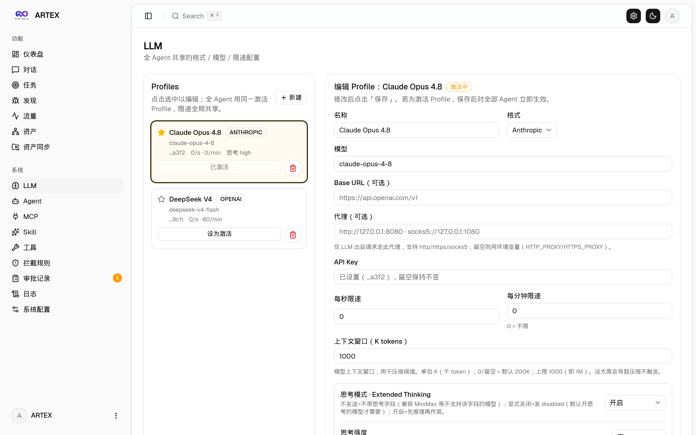
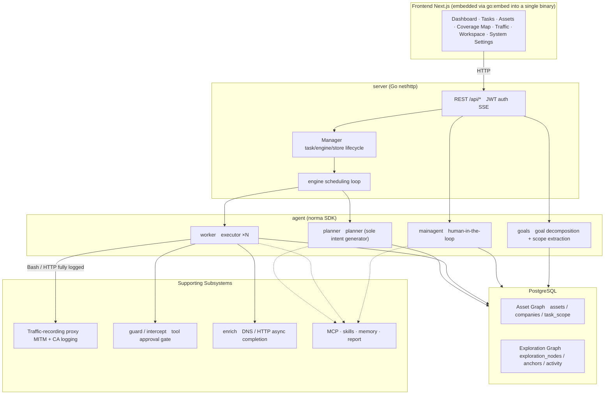
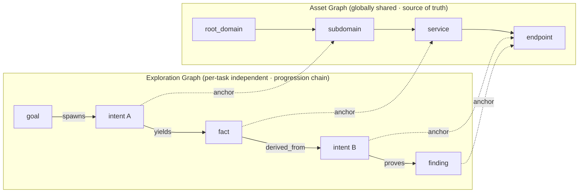
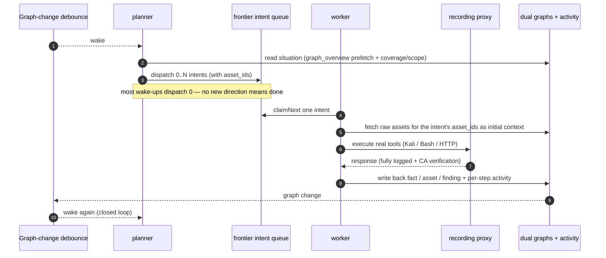
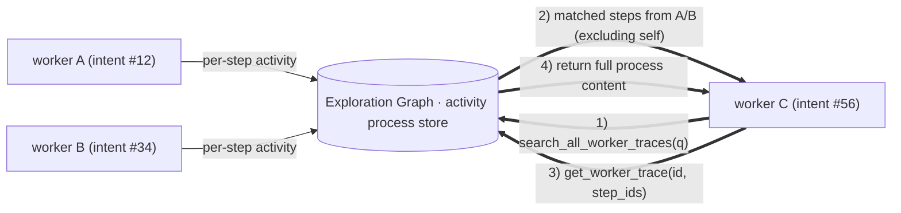
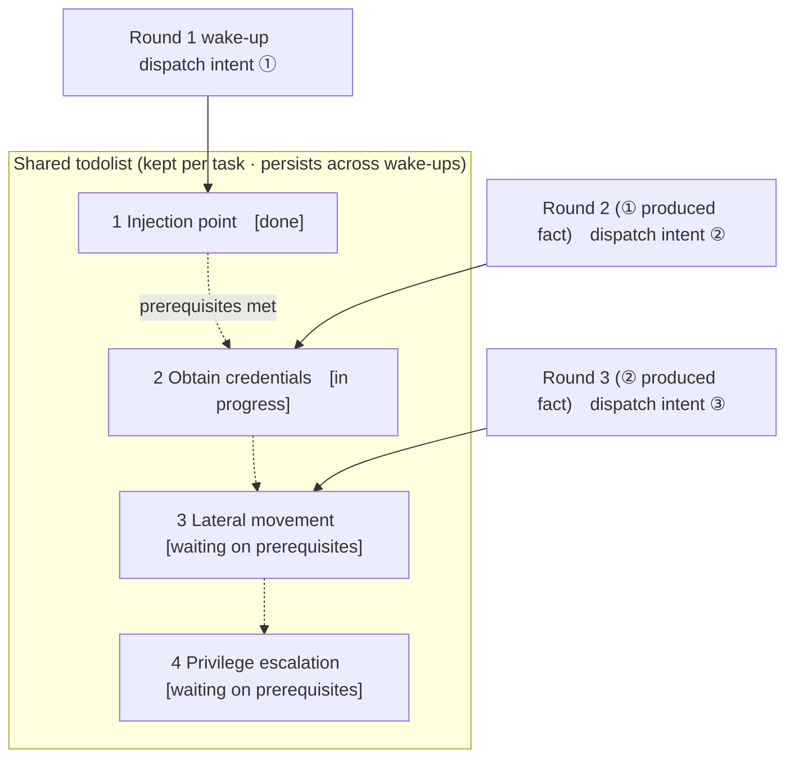

📦 **This repository is a pure-source backup of the final version of ARTEX. The original Docker deployment source is no longer available — simply have an AI build it locally for you.**

</div>

---

## Screenshots

> See the [online demo](https://artex-demo.vercel.app/) for the full interaction.

| Dashboard (Overview / Token Usage / Activity Stream) | Task List |
| :---: | :---: |
|  |  |

| Task · Execution Process (Sessions / Tool Calls) | Exploration Chain |
| :---: | :---: |
|  |  |

| Findings | Assets |
| :---: | :---: |
|  |  |

| Asset Coverage Map (force-directed layout · tested nodes highlighted · collapsible nodes) |
| :---: |
|  |

| Traffic Recording | Human-in-the-Loop Chat |
| :---: | :---: |
|  |  |

| Agent Management | LLM Configuration |
| :---: | :---: |
|  |  |

| Interception & Approval | Backend Logs |
| :---: | :---: |
|  |  |

---

## Approval Record Details

The global "Approval Records" page, the "Interception & Approval" tab within a task, and the approval cards in chat all support expanding to view details. The display structure references the [approval detail component from AegisHook](https://github.com/RuoJi6/AegisHook/blob/main/web/src/components/CallDetail.vue), reusing ARTEX's components and theme.

---

## Asset Synchronization (ScopeSentry)

Supports direct synchronization of asset data from [ScopeSentry](https://github.com/Autumn-27/ScopeSentry), eliminating duplicate collection:

- On the **Asset Sync** page, enter the ScopeSentry address and API Key to connect the data source;
- Select the targets and asset types to sync (domains / subdomains / IPs / ports / sites / endpoints…) by **project** or **task** dimension;
- One-click import, merged according to company asset scope, goes directly into ARTEX's asset graph for agents to explore.

---

## Installation

> Requires **PostgreSQL** as the database; exploration requires an **LLM** to be configured (`ANTHROPIC_API_KEY` or `OPENAI_API_KEY`, or configure it in the UI).

### Option 1: One-Click Install Script (Recommended)

```bash
git clone https://github.com/Autumn-27/ARTEX.git
cd ARTEX
./install.sh
```

The script will: detect / auto-install Docker → let you choose **① All Docker** or **② Local compile & run**:

- **① All Docker**: enter a Postgres password (press Enter for a random one) → `.env` is written automatically → `docker compose up -d`.
- **② Local run**: choose a database (connect to an existing one / start one with Docker) → generate `config.json` → compile an embedded single binary with `go` → start.

Once installed, open **http://localhost:8787** (on first visit, go to `/setup` to set the admin password).

### Option 2: Docker Compose (Manual)

```bash
git clone https://github.com/Autumn-27/ARTEX.git
cd ARTEX
cp .env.example .env          # fill in POSTGRES_PASSWORD, optionally ANTHROPIC_API_KEY
docker compose up -d          # pulls the autumn27/artex image + postgres
# → http://localhost:8787
```

The image already includes common tools (ripgrep/curl/vim/npm/nmap…); `./skills` and `./data` are persisted via bind mounts.

Remote MCP can be set to `http` (Streamable HTTP) or `sse` (legacy SSE) in system settings.
Legacy SSE services typically establish an event stream via `GET /sse` and then receive JSON-RPC requests through the `/message?sessionId=...` endpoint returned by the service; when configuring, set the URL to `/sse` and the header as `Authorization=Bearer <token>`.

### Option 3: Download Precompiled Binaries (Releases)

Download the zip for your platform from [Releases](https://github.com/Autumn-27/ARTEX/releases). After extracting you get `artex` + `start.sh` (`start.bat` on Windows) + `skills/` + `config.example.json`:

```bash
cp config.example.json config.json   # fill in the database connection
./start.sh                           # → http://localhost:8787
```

> Start with `start.sh` / `start.bat`, not by running `./artex` directly. It is a supervisor script: after the program exits, it decides whether to restart it based on the exit code, and **the [one-click update](#option-1-one-click-update-from-the-ui-recommended) on the web page relies on it to complete the swap**. If you run `./artex` directly, it won't be restarted after an update.
> Run in the background: `nohup ./start.sh >artex.log 2>&1 &`.

### Option 4: Compile a Single Binary from Source

```bash
# 1) Frontend static export
cd web && npm ci && npm run build:static && cd ..
# 2) Copy into the embed directory
cp -r web/out server/webui/dist
# 3) Compile (-tags embedui embeds the frontend)
CGO_ENABLED=0 go build -tags embedui -o artex ./cmd/artex
./start.sh
```

### Option 5: Build Cross-Platform Release Packages

`build.sh` first builds and embeds the frontend, then strips debug info with the Go linker, and compresses the release files into zips. Release mode by default generates zips for Linux amd64/arm64, macOS amd64/arm64, and Windows amd64:

```bash
./build.sh --release
# Output: dist/artex-0.3.3-*.zip
```

UPX self-extracting binaries may be incompatible with some Linux kernels, virtualized environments, or security policies, so it is disabled by default. You can customize targets with `ARTEX_TARGETS`; when you've confirmed the target runtime is compatible, pass `--upx` explicitly to further shrink the binary:

```bash
ARTEX_TARGETS=linux/amd64,windows/amd64 ./build.sh --release
./build.sh --target linux/amd64 --upx
```

---

## Updating & Upgrading

> Upgrading only replaces the program, not the data: the Postgres data volume `pgdata`, `./data` (jwt.key / SQLite, etc.), and `./skills` are all preserved. **No manual database migration is needed** — `artex` idempotently re-runs `schema.sql` (including `ADD COLUMN` / `CREATE INDEX IF NOT EXISTS`) on every startup, i.e. "restart equals migrate". Still, back up `./data` and the database before upgrading.

### Option 1: One-Click Update from the UI (Recommended)

On the **System Settings** page (sidebar "System Settings" → `/system/settings`), the **Version & Update** card lets you check for and install new versions directly — no server login required.

After clicking "Update": downloads the release package for the current platform → verifies against the Release's `SHA256SUMS` → smoke-tests the new binary with `-h` → stages it as `artex.new` → the program exits, and `start.sh` / `start.bat` relaunches it and completes the swap. The page automatically waits for the new version to come online, then refreshes.

- **A failed update leaves no broken program**: if verification or smoke-testing fails, the staged file is discarded and the current version keeps running; if the new version fails to start 3 times in a row after the swap, it automatically rolls back to `artex.old` (the failed one is kept as `artex.failed` for troubleshooting).
- **Rollback anytime**: the previous version is kept as `artex.old`, and the card has a "Roll back to previous version" button. Note that the database schema is not rolled back.
- **Updating interrupts running tasks** — an update means a restart, so do it during idle time.
- **Dev builds don't get updates**: disabled when the version is `dev` or `git describe` has a suffix, to avoid a release overwriting your local debug binary.
- **Under Docker, only the program is swapped, not the image**: the toolchains in the image (playwright / nmap, etc.) won't be upgraded, and after `docker compose up -d` recreates the container it reverts to the image-bundled version. To upgrade the image as well, use `docker compose pull artex && docker compose up -d artex`.
- If you need a proxy to access GitHub, just configure the **global proxy** on the same page and the update flow will use it. Updates are only downloaded from GitHub domains and force HTTPS.

### Option 2: One-Click Update Script

```bash
cd ARTEX
./update.sh
```

The script optionally runs `git pull` to fetch the latest code, then lets you choose **① Docker update** or **② Local compile update** (corresponding to `install.sh`):

- **① Docker**: you can specify a target image tag (press Enter to use `ARTEX_TAG` from `.env`, default `latest`) → `docker compose pull` → `docker compose up -d` (restart with the new image triggers automatic migration).
- **② Local**: rebuild the frontend static output → recompile `./artex` (restart the process afterward to take effect).

### Option 3: Docker Compose (Manual)

```bash
cd ARTEX
git pull                       # update compose / scripts (optional)
# Pin a version: set ARTEX_TAG=v0.2.0 in .env; otherwise uses latest
docker compose pull artex
docker compose up -d artex     # restart with new image → schema auto-migrates
docker image prune -f          # clean up old images (optional)
```

### Option 4: Precompiled Binaries (Releases)

Download the new version zip from [Releases](https://github.com/Autumn-27/ARTEX/releases), stop the old process, then overwrite `artex` and `skills/` (keep your `config.json` and `data/`), and restart:

```bash
cp -r <extracted-dir>/skills ./ && cp <extracted-dir>/artex ./
./start.sh
```

### Option 5: Compile from Source

```bash
git pull
cd web && npm ci && npm run build:static && cd ..
cp -r web/out server/webui/dist
CGO_ENABLED=0 go build -tags embedui -o artex ./cmd/artex
# restart ./start.sh
```

---

## Configuration

**Database** (`config.json`, or override with the environment variable `ARTEX_PG_DSN`):

```json
{
  "database": {
    "host": "127.0.0.1", "port": 5432,
    "user": "artex", "password": "yourpass",
    "dbname": "artex", "sslmode": "disable"
  }
}
```

**LLM**: `export ANTHROPIC_API_KEY=sk-...` (or `OPENAI_API_KEY`), or fill it in on the "LLM Configuration" page in the UI.
Optional: `ARTEX_LLM_PROVIDER` / `ARTEX_LLM_MODEL` / `ARTEX_LLM_BASE_URL` / `ARTEX_LLM_PROXY`.

**Concurrency**: the number of worker agents per task is configured in "System Settings" (default 3).

**Common flags**: `./start.sh -addr :8787 -proxy :8788` (`-addr` for frontend+API, `-proxy` for the traffic-recording proxy). The start script passes the flags through to `artex` unchanged.

### Reverse-Proxy Deployment (HTTPS / Only Expose 443)

Both the frontend and the API/SSE are served from the same backend port (default `:8787`), and the real-time activity stream uses the **same origin** by default, so **there is no need to configure `NEXT_PUBLIC_SSE_BASE`** — just expose 443 publicly and keep 8787 on the internal network.

SSE is a long-lived connection with continuous push; the reverse proxy **must disable buffering**, otherwise the browser can connect but receives no events (the activity stream appears to spin forever). Nginx example:

```nginx
server {
    listen 443 ssl;
    server_name your.domain.com;
    # ssl_certificate / ssl_certificate_key ...

    location / {
        proxy_pass http://127.0.0.1:8787;
        proxy_set_header Host $host;
        proxy_set_header X-Forwarded-Proto $scheme;

        # SSE essentials: disable buffering, long timeout, HTTP/1.1
        proxy_buffering off;
        proxy_cache off;
        proxy_read_timeout 3600s;
        proxy_http_version 1.1;
        proxy_set_header Connection "";
    }
}
```

> Only set `NEXT_PUBLIC_SSE_BASE` at **build time** if SSE needs to come from a different origin than the page (e.g. a separate subdomain) — this variable is baked into the static bundle during `next build` and has no effect when set on a running container.

---

## Development

### Manual Vulnerability Retesting

The "Retest" tab in the task detail page lets you page through the task's vulnerabilities, view past conclusions and evidence, and manually initiate a retest. Once started, the current tab stays open with a spinning icon and "Retesting"; once a fix is confirmed, the vulnerability status is updated accordingly.

Click "Retest" in the actions column of each row in the vulnerability list, or click "Start Retest" in the "Vulnerability Retest" section of the vulnerability detail page. Fill in optional fields such as the fixed version, test conditions, or constraints; the system creates an independent retest Agent session and keeps the current page open after starting. The entry point is supported in the list's flat view, task-grouped view, and asset view. While a retest is running, a spinning icon and "Retesting" are shown; click to enter the corresponding session to inspect it, and once it ends the button reverts to "Retest". Retesting does not require restarting the original scan task. Conclusions fall into "Still Reproducible", "Fixed", or "Cannot Confirm"; each conclusion, along with its evidence and session link, is saved in the vulnerability detail.

On first startup, the new backend pre-seeds an editable "Vulnerability Retest" (`retester`) Agent, whose prompt, LLM, run budget, and tools can be configured in Agent Management. By default it uses its bound LLM, or the globally active configuration if none is bound. When a retest session completes successfully with the conclusion "Fixed", the system automatically sets the vulnerability's disposition status to "Fixed"; in-progress, failed, stopped, or other conclusions keep the original status. Original evidence and reports are always preserved. You can also manually select "Fixed" from the status dropdown. If the same vulnerability is already being retested, the existing session is reused; you can start a new one after it is stopped, fails, or the service restarts.

In this version, retest history is viewed via the vulnerability detail and sessions; it is not yet included in vulnerability report exports or task archive packages, nor automatically associated with traffic captures. Demo mode only generates clearly-labeled simulated records and does not touch real targets.

### Local Run & Testing

```bash
./dev.sh    # backend(:8787) + traffic proxy(:8788) + frontend next dev(:5173) → http://localhost:5173
```

- Backend: `go run ./cmd/artex` (without `-tags embedui`, the frontend is not embedded)
- Frontend: `cd web && npm run dev` (`/api` is reverse-proxied to the backend, with hot reload)
- Tests: `go test ./...`
- Mock preview (no backend): `cd web && NEXT_PUBLIC_MOCK=1 npm run dev`

---

## System Architecture

ARTEX is an **LLM multi-agent-driven autonomous penetration testing system**: a Go monolithic backend (embedding the Next.js frontend) + PostgreSQL. Agent capabilities are provided by the [`norma`](https://github.com/Autumn-27/norma) SDK (`agentcore` / `tool` / `permission` / `harness` / `memory` / `transcript`). The core is a **dual-graph architecture**, together with two autonomy mechanisms built around it: **process-level information exchange between workers** and a **planner multi-round shared todolist that stabilizes attack chains**.

### Overall Layers



| Layer | Responsibility |
| --- | --- |
| **Frontend** | Next.js static export, embedded into a single binary via `go:embed`; visualizes tasks/assets/exploration chains/coverage map, human-in-the-loop chat |
| **server** | `net/http` routes + JWT auth + SSE; `Manager` manages the lifecycle of tasks, engines, and DB stores |
| **engine** | One `plannerLoop` + N worker goroutines per task; intent claiming, timeout/pause/drain |
| **agent** | goals / planner / worker / mainagent; `ToolSet` exposes the dual graphs as LLM tools |
| **db** | Postgres persistence of the dual graphs (pgx); schema is idempotently created on every startup via `go:embed` |
| **Supporting** | Recording MITM proxy, approval gate, async enrichment, MCP/skills/memory/report |

### Dual-Graph Architecture: Exploration Graph + Asset Graph

The system splits "**what is the target**" and "**how far has it been tested**" into two independent graphs connected by anchors:

- **Asset Graph (globally shared)**: a single source of truth for assets shared across tasks. Nodes are `root_domain / subdomain / ip / service / app / endpoint`, owned by companies; parent-child relationships (domain → subdomain → service → endpoint) and dedup keys are all computed by the program — agents only submit raw information.
- **Exploration Graph (per-task independent)**: the "thinking and progression" process of a single task. Nodes are `goal / intent / fact / finding / hint`, connected by edges such as `spawns / derived_from / yields / proves` into a **lineage chain**, answering "which direction was derived from which facts, and what it produced".
- **The two graphs are linked by anchors**: `exploration_anchors(node_id, asset_id)` anchors intents/facts/findings to specific assets — so you can look from an "exploration direction" at which assets it targets, and also look from "a given asset" back at which intents tested it in this task and which facts were derived. This also powers **asset test coverage** and the **asset coverage map** (in-scope assets + tested highlighting).



> Division of labor: the **planner** reads the exploration graph situation, judges goals, and dispatches **intents** into the frontier only when there are uncovered new directions; a **worker** claims **one intent**, executes it with real tools, writes new assets/facts/findings back to both graphs, and then stops. The asset graph is shared fact; the exploration graph is the per-task progression chain.

### Engine & Intent Lifecycle (A Closed Exploration Loop)

The engine is an **event-driven** loop: any graph change wakes the planner, the planner dispatches intents, workers claim and execute intents and write results back, and the write-back triggers the next round — until the goal is proven (`prove_goal`).



### Process-Level Information Exchange Between Workers

In a deep exploration, many valuable observations (an error message, a piece of response, a hidden parameter) appear in one worker's **execution process** without necessarily being written up as a formal fact. To avoid duplicated effort and let workers on the chain stand on each other's shoulders, workers can **search across work processes**:

- `search_all_worker_traces(q)`: keyword search within **other works' execution processes in this task** (automatically excluding steps of the caller's own intent); hits carry `intent_id`;
- `list_worker_traces` / `get_worker_trace(intent_id, step_ids=[…])`: first see which works have run, then fetch the full content of specific steps of a given work for detail exchange.

This way, even when no corresponding fact exists yet on the exploration graph, later workers can reuse observations from others' processes — **information flows between workers at "execution process" granularity**, while boundaries remain unchanged (each worker still only does the single intent it claimed).



### Planner Multi-Round Shared Todolist → Stable Attack Chains

Real attack chains are often **multi-step sequences with dependencies** (e.g.: find injection point → obtain credentials → lateral movement → privilege escalation); dispatching all of these in parallel at once would be chaos. The planner therefore keeps a **per-task planning todolist shared across wake-ups**:

- The planner is event-driven — it is woken whenever the graph changes, but **each wake-up is a brand-new session**; the shared todolist lets it **record a serial exploitation chain once** and then **dispatch intents step by step according to dependencies** across subsequent rounds, rather than expanding the whole chain up front in a single round;
- Each round only dispatches the next steps whose "predecessors are complete and the facts they depend on exist", and updates the list as progress is made (marking steps satisfied by facts as complete).



Thus, the attack chain **progresses stably, without repetition or misordering**, even in an "event-driven + stateless session" environment — this is the key to ARTEX autonomously completing multi-step exploitation chains.

---

## Community

Scan the QR code to follow the WeChat public account **SecSentry**, and send a direct message to it to join the discussion group.

<div align="center">


</div>

---

## References

https://github.com/oritera/Cairn

---

## License & Disclaimer

### Open-Source License

This project is licensed under the **GNU Affero General Public License v3.0 (AGPL-3.0)**; see the [LICENSE](LICENSE) file in the repository root for the full terms.

This means anyone may freely use, modify, and distribute this project, but **derivative works must also be open-sourced under AGPL-3.0**; in particular, **if you modify this project and provide it to users over a network (e.g. deploy it as an online service), you must also make the corresponding complete source code available to those users**.

> ⚠️ **Important**: the open-source license itself does not restrict how the software may be used. The "Usage Restrictions" and "Disclaimer" below are additional terms and solemn statements from the author for users, and must be observed.

**ARTEX is for personal learning, code research, and local technical validation only. It must not be used to conduct actual testing against any online system or website.**

### Permitted Use

- May only be used to **read, study, and research the source code of this project**, and to verify technical principles in a **locally isolated environment**;
- Applies to non-offensive purposes such as personal learning, academic research, and code review.

### Prohibited Actions

- **Strictly forbidden to use this tool to scan, probe, exploit, or attack any website, online service, or networked system** (regardless of authorization or whether the assets are your own);
- Strictly forbidden to use this tool for any real penetration testing, offensive/defensive confrontation, or production environment;
- Strictly forbidden to use this tool for illegal intrusion, data theft, ransomware, denial of service, or any destructive or criminal activity;
- Strictly forbidden to use this tool to violate the laws and regulations of your country/region.

### Compliance Responsibility

Users must comply on their own with all laws and regulations of their country/region regarding cybersecurity, data protection, and computer crime (in mainland China including but not limited to the Cybersecurity Law, Data Security Law, Personal Information Protection Law, and related judicial interpretations). **All legal liability and consequences arising from the use of this tool are borne solely by the user.**

### Disclaimer

This project is provided "AS IS", without any express or implied warranties. The author and contributors are not liable for any direct or indirect losses, data loss, system damage, or legal disputes caused by the use of this tool (regardless of whether it is used properly). **By downloading, installing, or using this project, you indicate that you have read, understood, and agree to all of the above terms.**

