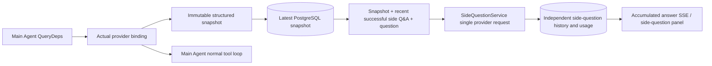

# ARTEX `/btw`

Normal chat, the task MainAgent, and the current task's own Worker support independent side questions. Enter `/btw question` in the main input box to submit; an empty `/btw` or the "Side Question" button opens the history. Desktop uses an adjustable-width sidebar, and mobile uses a Drawer.

Side answers are generated from the Agent context snapshot at submission time, supporting streaming display, follow-up questions, stop, and clear. Closing the panel, refreshing the page, or disconnecting the SSE will not cancel the model request. Stop only affects the current side question; clear cancels the side question and deletes the side-question history, while preserving the main context snapshot.

## Implementation Boundaries

Reuses Go, norma v0.3.7, Next.js, and the existing Markdown / ResizablePanel / Drawer / AlertDialog components; it does not modify norma source code or add dependencies for side questions. Planner, Workers inherited from other tasks, and tool-type subtask upgrades are out of scope for this change.

- `capture.go` only marks main-loop requests at `Options.Deps.CallModel / CallModelSync`. The Provider decorator is located inside the concrete model, after the outer route-pool selection, so it records the actually selected model; compaction and summary requests do not overwrite the snapshot.
- The snapshot is published at request start, the complete model reply, and the run terminal state. A half-generated reply is not published; tool calls are kept paired via norma's `MessagesForAPI`, and the tool result enters the snapshot at the next main model request or the run terminal state. A stream abort retains the last valid boundary.
- The snapshot preserves structured messages, system prompts, tool definitions, and generation parameters via a deep JSON copy. Model reasoning does not hold the snapshot lock or a database transaction.
- `SideQuestionService` calls the concrete Provider; when necessary it first generates a side summary, and the final answer is allowed to be retried once after reduction only when the context first exceeds the limit and no text/tool call has been output yet. It does not create an agent session, does not connect to the tool executor, main transcript, activity stream, or task graph, and does not go through the task model switching chain. The answer retains the tool definitions for compatibility with the existing structured tool context; the summary request does not provide tools. Newly returned tool calls have no execution path.
- One run request per parent session, at most four per service process, with a single timeout of 120 seconds. Side questions use an independent cancellation context under the service lifetime.
- A side request retains the model configuration reference and a non-sensitive identity summary; credentials are obtained from the existing configuration at request time. If the configuration is deleted, or identity fields such as model, protocol, or address change, the main Agent must first run to update the snapshot. Tests do not change the product default model.

## Persistence and Recovery

`db/schema.sql` automatically creates `side_question_sessions` and `side_question_requests`. The former stores the parent resource, latest snapshot, run number, version, and cleanup version; the latter stores the question, cumulative answer, status, model, snapshot time, usage, event ordinal, and paging ordinal.

The parent session key uses the conversation ID, or task ID + exploration ID + intent ID. Workers do not use reusable execution slot names.

Snapshots are written merged by parent session and refreshed at most once every 250 ms; the database compares `(run_id, version)` to prevent old versions from overwriting. The selected snapshot is saved again before submitting a side question. After a successful save, the large in-memory snapshot is released; on failure, the pending version is retained. The cumulative answer content is written at most once every 250 ms when streaming events arrive, and the terminal state is saved immediately with limited retries on database errors.

On service startup, leftover `running` requests are marked `interrupted`, preserving the partially persisted answer and usage, and requests are not automatically replayed. The most recently successfully saved context can be used directly for the next question. If a task main session has no main Agent snapshot, it uses a read-only task-level context when the task already has a description, Planner/Worker results, or finding records; each GET/POST rebuilds a synthetic snapshot `RunID=0, Version=0` from the current task material and current model. Historical leftover `(0,0)` rows in the database are used only for side-question session initialization, are not returned as the final context, and do not enter `side.latest/seen`; subsequent real checkpoints (`RunID>0`) always take priority. Sessions, Workers, and approval side questions still require their respective Agent snapshot or approval material; only when there is truly no usable material is the corresponding preparation method prompted.

Clearing increments the cleanup version and deletes requests; conditional updates prevent late callbacks from writing back. Physical parent resource deletion relies on foreign-key cascade; a Worker logical delete deletes side data in the same transaction and rejects subsequent late snapshots. Task archiving first blocks new requests, waits for the main flow to stop, cancels and waits for the side question to persist; the archive format is v3, and is also compatible with v1/v2 that do not contain the side table.

History is fully preserved and returns at most 20 entries per page by ordinal cursor. Model requests replay at most the most recent 20 groups of successful Q&A raw text, and the replay volume is also limited by the token budget; older Q&A maintain an independent rolling summary. When the main context exceeds the budget, only the old part of the side copy is summarized, retaining recent structured tool calls and results. Summaries, preparation progress, and usage are all included in the side question's concurrency, cancellation, and 120-second timeout limits. See [Context Budget and Open-Source References](CONTEXT_BUDGET.md) for details.

## HTTP Contract

The following paths are used as `{parent}`, reusing the existing authentication and resource validation:

- `/api/conversations/{id}`
- `/api/tasks/{id}/chat`
- `/api/tasks/{id}/intents/{iid}`

| Request | Response and Behavior |
| --- | --- |
| `GET {parent}/side-questions?before={ordinal}` | `items` ordered newest to oldest, an independent `current` running status, `snapshot` metadata, `next_cursor`; a cursor of 0 means the latest page / no next page |
| `POST {parent}/side-questions` | JSON `{ "question": "…", "client_request_id": "UUID" }`; a new request returns 202 with the request object; the same ID and question return the existing object 200 |
| `DELETE {parent}/side-questions` | Cancels and clears the current parent session's side questions |
| `GET /api/side-questions/{requestID}/events` | `snapshot` SSE event, with `id` as an incrementing ordinal and `data` as the complete cumulative request object; a `cleared` event is sent when clearing |
| `POST /api/side-questions/{requestID}/cancel` | Explicit cancellation; the terminal state can be read from history or the SSE |

The question limit is 4000 characters. No snapshot, model configuration changes, the same parent session busy, or an idempotency ID conflict return 409; the global concurrency limit returns 429. Every SSE connection first sends the cumulative state, not depending on text fragments the client received earlier. The frontend merges by request ID + ordinal, and discards old callbacks when switching parent sessions or clearing.

## Validation and References

Automated checks, real model usage, and known limitations are described in [VALIDATION.md](VALIDATION.md).

For independent request references see [Grok CLI side-question.ts (fixed commit)](https://github.com/superagent-ai/grok-cli/blob/fb97af83f06dca873281d60168430f06c8de6324/src/utils/side-question.ts), and for run isolation see [OpenCode (fixed commit)](https://github.com/anomalyco/opencode/tree/b3f1a96c6dd7adeb28b36dd11add1998fc84d67b). ARTEX's context uses norma's structured messages and does not adopt the approach of concatenating text from frontend logs.
