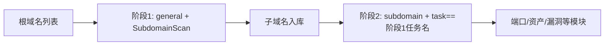

---

## name: scopesentry-mcp
description: Manage the security scanning platform through ScopeSentry MCP (projects, tasks, templates, assets, nodes). Use when the user mentions ScopeSentry, MCP, API Key, scan tasks, or asset queries.

# ScopeSentry MCP User Guide

For users with an **already deployed ScopeSentry instance**. Connect to the platform through Cursor (or another MCP client); no local source code is required.

## 1. Preparation

### 1.1 Confirm the service is reachable

- Default web UI: `http://<host>`
- MCP endpoint: `http://<host>/mcp` (if there is a reverse proxy or frontend proxy in front, use the actual `/mcp` address)

### 1.2 Create an API Key

1. Log into the ScopeSentry web UI in a browser
2. Go to the **API Key** management page and create a key (or create one through the interface provided by the administrator)
3. Save the returned `ssk_...` string (**shown only once**)

### 1.3 Configure Cursor MCP

Cursor → Settings → MCP → add server:

```json
{
  "mcpServers": {
    "scopesentry": {
      "url": "http://<你的主机>:8082/mcp",
      "headers": {
        "X-API-Key": "ssk_你的密钥"
      }
    }
  }
}
```

You can also use: `Authorization: Bearer ssk_<your key>`

After configuration, restart MCP or reload Cursor, and confirm that `list_projects`, `list_assets`, etc. appear in the tool list.

---

## 2. Tool overview


| Tool                     | Purpose                |
| ---------------------- | ----------------- |
| `list_projects`        | Project tree grouped by tag (including project ID) |
| `list_projects_data`   | Paginated project list, searchable by name     |
| `get_project`          | Project details              |
| `create_project`       | Create a project              |
| `list_tasks`           | Scan task list            |
| `get_task`             | Task details              |
| `list_scan_templates`  | Scan template list            |
| `get_scan_template`    | Template details              |
| `list_plugin_modules`  | Scan pipeline module names          |
| `list_plugins`         | Available plugins (including hash, default parameters) |
| `create_scan_template` | Create a scan template            |
| `create_scan_task`     | Create a scan task            |
| `list_assets`          | Query assets of various types (paginated list)       |
| `count_assets`         | Count assets (`/api/assets/common/total`) |
| `get_asset_detail`     | Asset or vulnerability details           |
| `add_asset_tag`        | Add a tag to an asset           |
| `list_nodes`           | Scan node list            |


Each tool's parameters are governed by the MCP tool description (schema); `list_assets` / `count_assets` share the same search and filter syntax, and you can read the `list_assets` description before querying assets.

When you need to know "how many in total", use `count_assets` (corresponding to the web pagination total endpoint) instead of repeatedly paging through `list_assets` just to count.

---

## 3. Common workflows

### 3.1 Query assets by project

When the user or context **already has a project condition**, prefer adding `filter.project` to narrow the scope and avoid too much cross-project data slowing the response. If there is no clear project, do not force a project filter.

1. Use `list_projects` or `list_projects_data` to get the target project's **ObjectID** (`id` / `children[].value`)
2. Pass `filter.project` to `list_assets` (**must be the ID; you cannot write the project's Chinese name**)

```json
{
  "asset_type": "asset",
  "pageIndex": 1,
  "pageSize": 20,
  "search": "domain=^example.com",
  "filter": {
    "project": ["<项目ObjectID>"]
  }
}
```

### 3.2 Create a scan task

1. Use `list_nodes` to get the online node names
2. Use `list_scan_templates` or `create_scan_template` to get the template's **ObjectID**
3. `create_scan_task`: `name` and `node` are required; `template` takes the template ID (the template name is not accepted)

**Target source `targetSource` (consistent with the web side):**

| targetSource | Description | Required parameters |
| --- | --- | --- |
| `general` | Enter targets directly | `target` |
| `project` | Read targets from a project | `project` (array of project ObjectIDs) |
| `asset` | Search from the web asset library | `search`; optional `project`, `filter`, `targetNumber` |
| `RootDomain` | Search from the root domain library | `search`; optional `project`, `filter`, `targetNumber` |
| `subdomain` | Search from the subdomain library | `search`; optional `project`, `filter`, `targetNumber` |
| `UrlScan` | Search from URL scan results | `search`; optional `project`, `filter`, `targetNumber` |
| `*Source` (such as `subdomainSource`) | Create from the asset page's "selected/searched" | use `search` when `targetTp=search`; use `targetIds` when `targetTp=select` |

**Example — scan root domains directly:**

```json
{
  "name": "example-子域名收集",
  "node": ["node-1"],
  "template": "<模板ObjectID>",
  "targetSource": "general",
  "target": "example.com\nfoo.com",
  "project": ["<项目ObjectID>"]
}
```

**Example — continue scanning from the subdomain library (filter by the previous task name):**

```json
{
  "name": "example-端口与漏洞",
  "node": ["node-1"],
  "template": "<后续模块模板ObjectID>",
  "targetSource": "subdomain",
  "search": "task==\"example-子域名收集\"",
  "project": ["<项目ObjectID>"]
}
```

### 3.3 Complete root-domain information collection (two phases recommended)

When the input is a **root domain** and you want **complete information collection**, it is recommended to run two scans rather than the whole pipeline at once.

**Reason:** distributed tasks are dispatched **per single target**. When a root domain is the target, after a node receives that root domain, the subdomains discovered on that node will also continue executing subsequent modules on that node, which easily causes uneven load, slow speed, and errors.

**Best practice:**

1. **Phase 1 — subdomain collection only**
   - `targetSource`: `general`
   - `target`: all root domains (multiple lines)
   - Template: enable only `SubdomainScan`, `SubdomainSecurity` (subdomain scan + subdomain takeover)
   - Use `get_task` to wait for the task to complete

2. **Phase 2 — subsequent modules**
   - `targetSource`: `subdomain`
   - `search`: `task=="<phase 1 task name>"` (exact task-name match)
   - Optional `project` to narrow the scope
   - Template: port scanning, asset mapping, vulnerability scanning, etc. (may exclude SubdomainScan)
   - Subdomains are dispatched to each node as independent targets, giving higher parallel efficiency

You can also filter by task name on the "subdomains" asset page in the web UI, then use "Create task from subdomains" for the same effect.



### 3.4 Create a scan template

1. `list_plugin_modules` → module name list
2. `list_plugins` (can be filtered by `module`) → each plugin's `hash` and default `parameter`
3. `create_scan_template`: use `modules` to specify a "module → plugin hash array" mapping

---

## 4. Asset query (`list_assets` / `count_assets`)

`count_assets` uses the same `asset_type`, `search`, and `filter` as `list_assets`, returns `{ "total": N }`, and corresponds to the web side's `/api/assets/common/total`.

```json
{
  "asset_type": "subdomain",
  "search": "task==\"某任务名\"",
  "filter": {"project": ["<项目ObjectID>"]}
}
```

**Performance tip (common to `list_assets` / `count_assets`):** when there is a project condition, prefer `filter.project` to narrow the scope; in `search`, use `==` exact match or `^` prefix match as much as possible for indexed fields (see [4.3](#43-search-搜索表达式)), and avoid large-scale `=` fuzzy queries that slow the response. Without a project context, do not force a project filter.

For the types that support `filter.project`, see the table in [4.4](#44-filter-精确过滤).

### 4.1 Asset type `asset_type`

`asset`、`RootDomain`、`subdomain`、`app`、`mp`、`UrlScan`、`SensitiveResult`、`DirScanResult`、`crawler`、`vulnerability`、`PageMonitoring`、`IPAsset`、`SubdomainTakerResult`

Alias examples: `web`→asset, `vuln`→vulnerability, `ip`→IPAsset, `url`→UrlScan

### 4.2 Parameter notes


| Parameter                       | Description                                      |
| ------------------------ | --------------------------------------- |
| `pageIndex` / `pageSize` | Pagination, default 1 / 20                            |
| `search`                 | Search expression (see next section)                              |
| `filter`                 | Exact-match filter JSON (see next section)                          |
| `sort`                   | Only UrlScan and DirScanResult support sorting by `length` |
| `sid`                    | SensitiveResult only: sensitive rule name                |


`search` and `filter` **can be used together**.

### 4.3 search expression

Custom DSL (**not SQL**):


| Operator  | Meaning   | Index | Example                          |
| ---- | ---- | ---- | --------------------------- |
| `=`  | Fuzzy match (regex) | not indexed | `domain=example`            |
| `==` | Exact match (full equality) | **indexed** | `port==443`                 |
| `!=` | Exclude   | — | `port!="80"`                |
| `&&` | AND    | — | `domain==example.com && port==443` |
| `||` | OR    | — | `title=admin || body=login` |


**Indexes and operators:** fields such as `domain`, `ip`, `port`, and `title` are indexed, but only **`==` exact match** or **prefix match with a value starting with `^`** (such as `domain=^example.com`) can use the index; **`=` becomes a regex fuzzy match and cannot use the index**, and is easily slow with large data volumes.

**search fields common to all types:** `tag`, `task` (task name), `rootDomain`

**`project` cannot be written in `search`** (it is invalid, or errors when combined with `&&`). To filter by project, use `filter.project`.

**Common search fields per type:**


| asset_type           | Fields                                                                              |
| -------------------- | ----------------------------------------------------------------------------------- |
| asset                | domain, ip, port, service, app, title, statuscode, icon, banner, type, body, header |
| RootDomain           | domain, icp, company                                                                |
| subdomain            | domain, ip, type, value                                                             |
| app                  | name, icp, company, category, description, url, apk                                 |
| mp                   | name, icp, company, category, description, url                                      |
| UrlScan              | url, input, source, resultId, type                                                  |
| SensitiveResult      | url, sname, body, info, md5                                                         |
| DirScanResult        | url, statuscode, redirect, length                                                   |
| vulnerability        | url, vulname, matched, request, response, level                                     |
| crawler              | url, method, body, resultId                                                         |
| PageMonitoring       | url, hash, diff, response                                                           |
| IPAsset              | ip, domain, port, service, webServer, app                                           |
| SubdomainTakerResult | domain, value, type, response                                                       |


**search examples:**

- `domain==www.example.com && port==443` (exact match, indexed)
- `domain=^example.com` (prefix match, indexed)
- `ip==192.168.1.1`
- `task=="<some task name>"`
- `level==high` (vulnerability)
- `statuscode==200` (DirScanResult)

Use `=` only when you need fuzzy containment, such as `title=admin` (not indexed; best combined with conditions like a project to narrow the scope).

### 4.4 Exact filter

JSON object: multiple values for the same key are **OR**; different keys are **AND**.

**When there is a project condition, prefer `project`:** if the user or context already specifies a project and asset_type supports `project`, include it to narrow the scope; do not force it when there is no project information.


| filter key   | Meaning       | Value description                                                     |
| ------------ | -------- | -------------------------------------------------------- |
| `project`    | Owning project     | **ObjectID**, obtained via `list_projects` / `list_projects_data` |
| `task`       | Source task     | **Task name**, from `list_tasks`'s `name`                         |
| `port`       | Port       | such as `"443"`                                                |
| `service`    | Service/protocol    | such as `"https"`                                              |
| `app`        | Application fingerprint     | such as `"Nginx"`                                              |
| `icon`       | Icon hash  |                                                          |
| `statuscode` | HTTP status code | mainly for asset                                               |
| `status`     | Status       | UrlScan/DirScan HTTP code; vulnerability/sensitive-information handling status                       |
| `level`      | Vulnerability level     | critical / high / medium / low / info                    |
| `type`       | Type       | such as subdomain record type A, CNAME                                         |
| `color`      | Sensitive rule color   | SensitiveResult                                          |
| `sname`      | Sensitive rule name    | SensitiveResult                                          |
| `tags`       | Tags       |                                                          |


**Available filter keys per type:**


| asset_type                            | filter key                                                      |
| ------------------------------------- | --------------------------------------------------------------- |
| asset                                 | project, port, service, app, icon, statuscode, type, task, tags |
| RootDomain                            | project, tags                                                   |
| subdomain                             | project, type, task, tags                                       |
| app / mp                              | project, tags                                                   |
| UrlScan                               | status, tags                                                    |
| DirScanResult                         | status, tags                                                    |
| SensitiveResult                       | status, color, sname, tags                                      |
| crawler                               | project, task, tags                                             |
| vulnerability                         | project, level, status, task, tags                              |
| PageMonitoring / SubdomainTakerResult | tags                                                            |
| IPAsset                               | project, port, service, app                                     |


**filter example:**

```json
{"project": ["<项目ObjectID>"], "port": ["443"]}
```

**Combined query example:**

```json
{
  "asset_type": "asset",
  "search": "domain=^baidu && port==443",
  "filter": {"project": ["<项目ObjectID>"]},
  "pageIndex": 1,
  "pageSize": 10
}
```

**Note:**

- When there is a project condition, prefer including `filter.project` (when supported); without a project context, do not force it
- Do not put the project display name in `filter.project`
- Use `==` for known values and `^` for prefixes; avoid abusing `=` fuzzy matching on large tables
- UrlScan's HTTP status uses `filter.status`; DirScanResult can use `statuscode==200` in search
- SensitiveResult by rule name: use `sname=<rule name>` in `search`, or `filter.sname`

### 4.5 Sorting `sort`

Supported only by **UrlScan** and **DirScanResult**:

```json
{"length": "ascending"}
```

Other types ignore `sort` and sort by time by default.

---

## 5. Scan template module names

`TargetHandler`、`SubdomainScan`、`SubdomainSecurity`、`PortScanPreparation`、`PortScan`、`PortFingerprint`、`AssetMapping`、`AssetHandle`、`URLScan`、`WebCrawler`、`URLSecurity`、`DirScan`、`VulnerabilityScan`、`PassiveScan`

---

## 6. Troubleshooting


| Symptom        | Handling                                                 |
| --------- | -------------------------------------------------- |
| MCP has no tools   | Check the URL, API Key, and whether ScopeSentry is running                    |
| 401 / 403 | Recreate or replace the API Key                                    |
| Assets not found     | Confirm `filter.project` is an ObjectID; do not write project in search |
| Template/task creation fails | `template` must be the template ObjectID; `node` takes an online node name            |
| Query is slow/stuck   | Add `filter.project` when there is a project; for indexed fields in search use `==` or `^` prefix instead of `=`; reduce `pageSize` |


---

